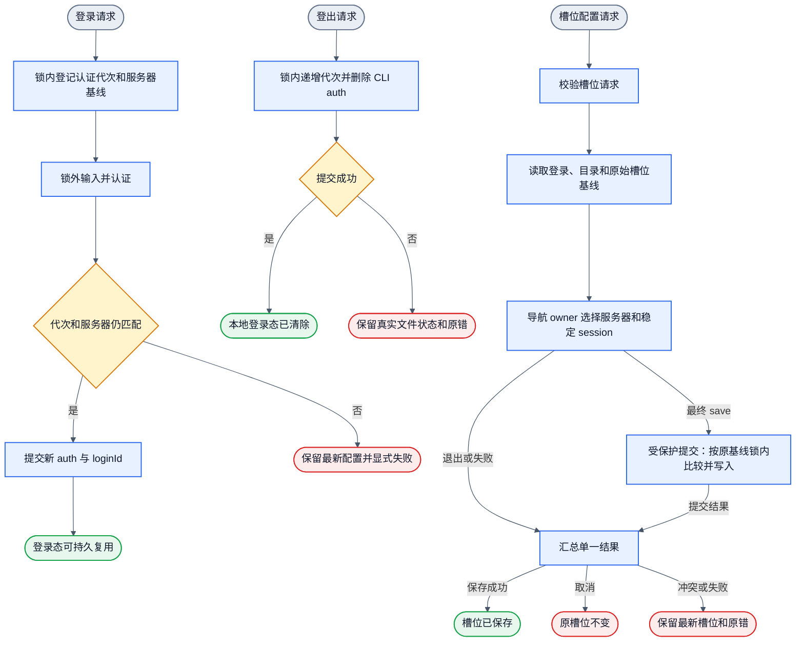
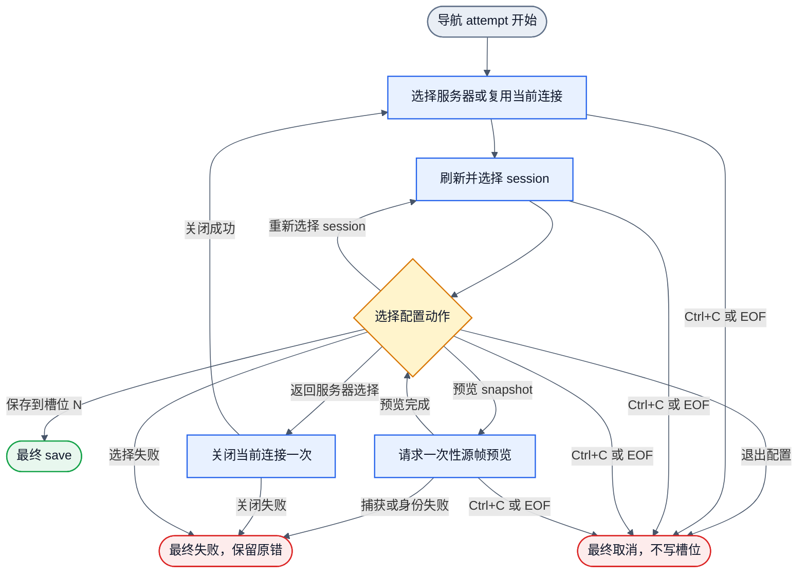
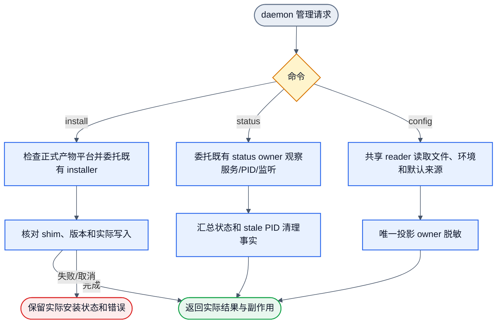

# 2026-10-20 Remote daemon CLI design
状态：`DESIGN_PASS`；三平台 CLI、原生包及 daemon 安装 gate 已 PASS。Windows
外部 RTC 已通过真实连接验收；独立 Review 的登录、取消及 session 身份问题均已修复并通过独立复核。集成状态见 PR #167。本文是已审设计与
当前实现边界的项目入口；平台安装通过不能替代远程连接验收。

本次槽位导航改动归入 CLI 0.1.3 候选。在候选构建和安装后验收完成前，以下 action 菜单只
表示候选契约，不表示该改动已集成或已交付。已安装的一次性快照行为沿用既有验收证据。

| 当前项 | 事实 |
|---|---|
| 正式入口 | `packages/cli/src/main.ts` 已落地并接通 argv、登录、槽位、终端、升级和 daemon 管理。 |
| 构建产物 | `packages/cli/dist/main.mjs` 由正式入口构建；本地 tarball 可隔离安装。 |
| npm 发布 | `@jsonstudio/zterm-cli` 尚未发布到公开 npm；隔离 tarball 不是公开渠道证据。 |
| 平台验证 | Windows x64、macOS arm64、Linux x64 的构建、安装、升级和适用用户链通过；Windows 外部 RTC 在 CI 39707241211 通过原始 2500ms 期限和实际 relay/relay 断言。此前超时记录保留；一次通过不证明所有网络下的延迟可靠性。 |

## 1. 范围与命令
交付全局命令 `zterm`。它使用持久账号登录态、账号设备目录和 1～20 槽位，连接现有
daemon session，并显示 canonical mirror。

```text
zterm login | zterm login --from-config | zterm logout
zterm slot set <1..20> | zterm slot list | zterm <1..20> | zterm
zterm upgrade [--registry <url>]
zterm daemon install | zterm daemon status | zterm daemon config
```
无参数 `zterm` 只列出已配置槽位并让用户选择；编号入口不重新询问服务器和 session。
槽位失效、未登录或登录失效必须显式失败，不得切换目标、按名称重绑或创建同名 session。
首轮不包含 session 创建/重命名/删除、远程 daemon 安装、daemon 启停或开机服务、
账号全部设备登出、配置格式迁移、跨重启输入 exactly-once。目标平台为 Windows、macOS、Linux。
各平台分别提供产物与真实 CLI 验收；缺证据时明确未验证，不将目标缩为仅 macOS arm64。
用户已明确 Android 设备、模拟器、APK 和 OTA 不在本任务范围，也不作为 CLI 交付前置。

### 用户操作目标

发布后的正常路径只需一份共享配置，不需要另建 CLI 配置文件，也不需要在每条命令上
重复填写 Relay 或 daemon 地址。

| 目标 | 命令 | 说明 |
|---|---|---|
| 安装 | `npm install --global @jsonstudio/zterm-cli` | Node.js 22 或更高版本；公开发布待完成。本地开发使用构建后的 tarball 隔离安装。 |
| 登录 | `zterm login` | 交互输入账号和密码；已有 Relay 地址时不再询问地址。 |
| 一次性配置登录 | `zterm login --from-config` | 只用于受控的一次性自动化，密码在请求前消费。 |
| 配置槽位 | `zterm slot set 1` | 槽位为 1～20；交互选择服务器、稳定 session 和可选快照预览，然后选择保存、重新选择 session、返回服务器选择或退出配置。该交互是 CLI 0.1.3 候选。 |
| 查看槽位 | `zterm slot list` | 只读本地绑定，不刷新远端目录。 |
| 选择或启动 | `zterm` 或 `zterm 1` | 无参数只选择已保存槽位；编号直接使用精确绑定。 |
| 查看本地终端 | `Ctrl+]` 后按 `k/j/u/d/h/l/f` | 翻行、翻页、横向平移或回到 follow。 |
| 本地退出 | `Ctrl+]` 后按 `q` | 只断开本地连接，不删除或停止远端 session。 |
| 登出 | `zterm logout` | 只清本地 CLI 登录态；不宣称撤销远端已经签发的 token。 |
| 升级与管理 | `zterm upgrade`、`zterm daemon install/status/config` | upgrade 只升级 CLI；daemon install 不启动或重启服务。 |

## 2. 架构映射与十一图
CLI 新增终端消费者，不复制 runtime 源码，不改变 daemon 的 tmux/mirror/transport 真源。

连接算子可接收可选的 `rtcIceTransportPolicy` 控制输入。应用 API 的第四参数传递该输入，
经 `SessionConnection` 进入共享 traversal settings；目标身份仍只有 device/daemon ID。
省略输入时保留原有 auto 行为。显式 `relay` 时，共享 planner 不生成 `rtc-direct`，
保留原有 WebSocket 候选和使用原始 TURN 账号数据的 `rtc-relay` 候选。此输入不写入
共享配置或槽位，不增加 UI 配置项，也不改变连接期限、输入协议或 graph 拓扑。

外部 TURN 验收通过真实 `createApplicationConnection` 指定该策略，并继续核对实际
`open`、`rtc-relay`、`turn` 和双端 `relay` 统计。请求策略或连接成功均不替代实际统计。
本地 direct 验收省略策略。目录候选过滤不能约束共享 planner 生成的 RTC direct 路径。
账号、槽位、terminal 和 daemon 命令分别处理；成功、失败、取消、未确认和清理结果在各自
对象流唯一出口汇总。

| 图 | 职责 | 唯一 owner 边界 |
|---|---|---|
| `cli-account-login.graph.json` | 登录与持久化 | account-state；shared-config 提交 |
| `cli-account-logout.graph.json` | 本地登录态失效 | account-state；连接按 loginId 收口 |
| `cli-slot-configure.graph.json` | 校验请求、读取槽位上下文、交互导航、受保护提交和单一结果汇总 | slot owner；shared-config 提交 |
| `cli-slot-launch.graph.json` | 读取、选择或连接槽位 | CLI connection；route/mux owner |
| `cli-terminal-mirror-event.graph.json` | 帧、sparse、renderer 投影 | frame assembly/sparse/renderer |
| `cli-terminal-input-event.graph.json` | 本地意图与远端输入 | local-input；reliable-input core |
| `cli-terminal-close.graph.json` | 退出与终端恢复 | terminal-lifecycle |
| `cli-self-upgrade.graph.json` | npm CLI 升级 | CLI release adapter；npm |
| `cli-daemon-install.graph.json` | 本机全局 daemon 安装 | 既有 installer/shim owner |
| `cli-daemon-status.graph.json` | daemon 状态查询 | 既有 status owner |
| `cli-daemon-config.graph.json` | daemon 配置脱敏投影与本地 tmux 配置 mutation | shared reader/writer；config projection；tmux resolver |



### 槽位导航与连接生命周期

`cli-slot-configure.graph.json` 只保留命令级五步 SESE：
校验请求 → 读取上下文 → 导航 owner → 受保护提交 → 单一结果汇总。
`cli.slot_configure.navigate` 是 `slotSetCommand` 的声明式架构映射，不是可执行 operator
注册项。导航 owner 内部封装服务器和 session 循环；这些返回动作只记录为下面的独立状态机，
不写成 DAG 回边，也不新增框架。

每次导航尝试依次执行：选择服务器或复用当前连接 → 刷新/选择 session（携带
`{ backend, stableId }` 精确身份）→ 选择配置动作。动作只有
`save | preview | sessions | servers | exit | failed`。`preview` 是当前 session 的可选一次性
源帧预览，完成后回到同一动作菜单；`sessions` 和 `servers` 是导航内部继续动作；只有最终
`save` 到达受保护提交。导航 owner 最终只返回保存、取消或失败；其他结果原样进入单一结果汇总。

| 动作 | 行为 |
|---|---|
| 保存到槽位 N | 用当前选择构造绑定，并以导航开始前的原始槽位基线执行锁内比较提交。 |
| 预览 snapshot | 只对当前选择的精确 `{ backend, stableId }` 请求一次性源帧预览；完成后回到同一五动作菜单，可在同一连接和同一原始基线上再次预览或选择其他动作。捕获失败或身份不一致时最终失败，不写槽位。 |
| 重新选择 session | 在当前连接上刷新 session 目录并形成新的选择 scope；丢弃旧选择和预览，不复用旧目录下标；cleanup scope 不变。 |
| 返回服务器选择 | 展示保留的服务器目录前先关闭当前连接一次；下一次服务器选择后才建立新连接。 |
| 退出配置 | 取消整个配置，不写槽位；当前连接关闭一次。 |

认证、账号目录和原始槽位基线在导航循环外读取一次。每个成功打开的连接只有一个 cleanup
scope 和一个新的关闭 guard；session 重选留在同一 scope，返回服务器选择必须先关闭旧 scope。
关闭失败会显式报告并停止，不能在 cleanup 未解决时打开新连接。所有提示上的 `Ctrl+C` 和
EOF 都取消整个命令，且不写槽位。槽位冲突返回 `slot_changed`，保留最新绑定，不把导航中的
新草稿提升为基线。只有保存动作写槽位，并沿用原 alias 和 width mode 规则；导航不写中间
绑定。保存已持久化后再发生 cleanup 失败时，仍保留已写入结果，同时显式报告 cleanup 错误。

导航状态机（独立视图，不是 DAG；允许 session 和服务器返回边）：



## 3. 共享配置与事务
CLI 与 daemon 共用当前真实文件 `~/.zterm/config.json`。CLI 不提供独立配置路径，
不引入 TOML，不推动迁移。所有合作 writer 通过
`packages/shared/src/node/shared-config.ts` 执行字段级事务。

```json
{
  "zterm": {
    "android": { "daemon": {
      "host": "0.0.0.0",
      "port": 3333,
      "authToken": "<daemon-token>",
      "sessionName": "zterm-daemon-3333",
      "terminalCacheLines": 3000
    }},
    "cli": {
      "server": { "relayBaseUrl": "https://relay.example/zterm/" },
      "loginInput": { "username": "<account>", "password": "<one-time-password>" }
    }
  }
}
```

Increment A 增加唯一的 canonical tmux 配置块。下例中的 `<uid>` 表示当前用户
数字 UID，不是固定值：

```json
{
  "zterm": {
    "android": {
      "daemon": {
        "tmux": {
          "sockets": [
            {
              "name": "main",
              "socketPath": "~/.tmux/run/tmux-<uid>/default"
            },
            {
              "name": "old",
              "socketPath": "/private/tmp/tmux-<uid>/default"
            }
          ],
          "primary": "main"
        }
      }
    }
  }
}
```

`sockets` 是非空、有序的显式允许路由。`name` 是唯一显示标签和 CLI 选择键，
不进入 stable ID。`socketPath` 只接受绝对路径或以 `~/` 开头的路径；保存原字符串，
使用时相对共享配置的 home 展开一次，不展开其他环境变量，不执行 shell，不使用
`realpath()` 改写身份路径。`primary` 必须引用一个已配置 socket，只供显式创建新 session
使用。

canonical tmux 块缺失时，派生一个名为 `default` 的路由：

```text
~/.tmux/run/tmux-<current uid>/default
```

只读取和写入 `zterm.android.daemon.tmux`。不新增 `mobile.daemon.tmux` 兼容 reader 或
writer；该旧位置如含未知数据必须原样保留。malformed canonical 块显式失败，不回退到默认。
记录中的 portable `~/` 不得改写为绝对路径。没有可用原生 tmux 后端或默认 UID 的平台上，
显式 route 的存储和无关 daemon 配置投影仍可用；tmux 默认解析返回明确 unsupported，
不得虚构 UID 或 socket 路径。

本机配置命令：

```sh
zterm daemon config
zterm daemon config tmux set main --socket '~/.tmux/run/tmux-501/default'
zterm daemon config tmux set old --socket /private/tmp/tmux-501/default
zterm daemon config tmux primary old
zterm daemon config tmux remove main
```

第一次 `set` 创建 tmux 块并把该路由设为 primary；后续 `set` 新增或更新一个具名路由。
还有其他路由时不得删除 primary；不得删除最后一条路由。所有 mutation 通过唯一
`SharedConfigStore.update` 在锁内读取最新文档后校验并提交，保留 auth、slots、relay、
其他 daemon 字段、未知字段以及未更新 socket entry 的未知字段。空路径、非 `~/` 相对路径、
重复 name、重复解析路径、缺失 primary 或目标容器结构错误必须在提交前失败，且不得替换原文件。

`zterm daemon config` 直接通过 `SharedConfigStore.read` 和共享 projection 读取本机文件，
不调用已安装的 `zterm-daemon config`、不执行 home migration、不创建配置、不获取写锁、
不联系 Relay、不启动 daemon。读取文件缺失时报告 absent，不创建文件。输出保留现有脱敏
daemon 字段，并增加 socket 标签、stored/resolved path、primary、来源位置和
`runtimeLoaded: unknown`。mutation 输出必须给出真实文件路径、已写入变化和“下一次 daemon
启动生效，当前运行进程未应用”的事实；不得把文件投影冒充运行态真源。

以上只列出用户可提供的最小配置。当前 typed owner 还使用以下 CLI 管理字段；正常操作时
不要手工编辑：

| 字段 | 当前 owner |
|---|---|
| `zterm.cli.authGeneration` | `AccountState` 维护本机登录代次。 |
| `zterm.cli.auth` | 登录成功后保存当前本机 CLI auth；不用于 daemon 鉴权。 |
| `zterm.cli.slots.<1..20>` | `SlotStore` 保存 account、server、session 和 `widthMode`。 |

`zterm.android.daemon.authToken` 只用于 daemon 鉴权，不能替换 Relay 账号 token。示例中是
占位符，不是可复制的秘密实值。用户不要把主机 OS、设备名或其他平台的地址推断成远端
地址；服务器和 session 来自账号目录与已保存槽位。

`zterm login --from-config` 只读取 `zterm.cli.loginInput.username` 和
`zterm.cli.loginInput.password`。密码在发送认证请求之前随开始事务消费；认证失败后不恢复。
优先使用交互登录。必须使用一次性配置输入时，先限制文件权限：macOS/Linux 可在文件创建后
执行 `chmod 600 ~/.zterm/config.json`；Windows 使用系统文件安全工具把 ACL 限制到当前用户。

`authGeneration` 缺失按 `0` 解释，必须是非负安全整数，不是 token。登录开始在短事务内
递增并记录服务器基线；网络等待不持锁。成功后重新读取，只有代次和服务器字段都未改变才
原子提交 auth，并生成新 `loginId`；否则返回 `login_superseded` 或
`login_server_changed`。失败和取消不回退代次，不清除原 auth，也不恢复较早请求资格。
`login --from-config` 在同一开始事务消费 `loginInput.password`；消费提交失败时不发送
认证请求，认证失败后密码不恢复。普通命令不自动读取或使用该密码。`logout` 无论 auth
是否存在都递增代次并删除 auth，提交成功后才报告本地登出。活动连接按 `auth.loginId`
变化或消失关闭，不能按代次误关仍有效的旧连接。
事务在锁内重读完整 JSON，修改目标字段，私有临时文件加 rename 提交。无效 JSON、非对象根
或目标分区结构错误必须失败，不能当空对象覆盖；保留 daemon、其他及未知字段。`slot set`
在提交时比较交互开始时的目标槽位，变化则返回 `slot_changed`，保留最新槽位。锁只约束
合作 writer，不能承诺约束手工编辑和旧版直接覆盖程序。不同字段更新在锁内重读后合并。
## 4. 目录、稳定身份与 snapshot
账号目录只从有 daemon 的设备生成服务器候选，使用 `deviceId`、`daemon.hostId`、
`presence` 和 endpoints。账号 token 只用于账号与 relay；daemon endpoint authToken
只用于 daemon 鉴权，二者不得互换。路由沿用
`lan -> tailscale -> ipv6/ipv4 -> rtc-relay -> rtc-direct`，失败不换绑定目标。
CLI 的 catalog entry 必须含 `name`、`backend`、`stableId`，可选 `cwd`。tmux 身份由
实际 socket、server 进程代次、`session_id` 和创建事实组成；Herdr 使用 `terminalId`
与 pane identity。`stableId` 是不透明值，CLI 不解析内部结构；名称只用于显示，没有稳定
身份时不得保存槽位。catalog、snapshot 和 open 使用同一 resolver。

Increment A 的 catalog 只枚举 canonical tmux 配置中的显式路由，每条路由使用自己的
`tmux -S <resolved path>` 读取，不再按环境或文件系统做隐式 discovery。catalog 直接由
native target 构建，CWD 必须在同一路由读取并按 native identity 关联。不同 socket 上的
同名 session 都保留并使用可读标签区分，例如：

```text
work [tmux · main]
work [tmux · old]
```

标签只用于显示，不进入 stable ID。显式路径旧绑定的身份编码保持不变；改变标签不改变身份，
改变 socket path 是路由变化，可以令旧绑定显式失效。未配置路由或旧的无 socket path 身份
不得按同名或 primary 重绑。

单条路由不可用时，现有 `sessions` payload 和 resident catalog result 使用同一 optional
字段携带失败。成功入口与失败并排返回，picker 逐条显示失败，可达到的 entries 仍可选择：

```ts
routeFailures?: Array<{
  socketName: string;
  socketPath: string;
  code: string;
  message: string;
}>
```

该字段必须经过 catalog builder、resident catalog/cache、publisher、protocol、CLI
connection result、main projection 和 picker。cached resident read 必须保留与 entries
同一快照的 failures，不能丢弃。message 不含凭据。全部 configured routes 都失败时，返回带
correlation 的 request-level catalog error，不伪造成功空目录；某条 route 可达但 session
数为零是成功 empty enumeration，不算该 route 失败。不得回退到未配置路由，也不得因读取
启动 tmux server、session、keepalive 或创建目录。

`mux-channel-open` 必须同时携带 `expectedSessionIdentity` 和 `existingOnly: true`。
daemon 在创建 subscriber、mirror 或 lease 前解析精确 target；不符返回
`session_identity_mismatch`，不存在返回 `session_not_found`。`mux-channel-opened`
返回的 stableId 再由 CLI 核对。禁止按显示名称二次选择或进入创建路径。
snapshot 使用 `mux-target-message`：
```ts
{ type: 'terminal-snapshot-request',
  payload: { version: 1, backend, stableId, maxLines } }
```
成功时把同一 revision 的 head 和 body 按 `maxLines` 投影后一起序列化返回。
`terminal-snapshot-request` 的显式预览是窄例外：它经 `daemon.mirror_writer` 既有权威捕获/
规范化管线，对精确
`{ backend, stableId }` 解析出的原生 target 做一次请求局部的一次性源捕获，再复用 snapshot
serializer。没有 ready mirror 或完全没有 live mirror 都返回这次新捕获的帧，不再返回
`mirror_not_ready | mirror_not_present`；捕获失败或超时显式返回有界请求错误，不得用缓存的
live frame 冒充成功。读取前后都校验同一 backend 与 stableId；删除、server 替换或身份变化
显式失败，不按同名 target 重试。捕获结果只进入 detached 请求局部状态：不写入或克隆 live
mirror，不改变 mirror revision、subscriber、adaptive holder、publisher pending，也不触发
attach、input、resize、createSession、capture timer 或 lease。快照 owner 只获得 resolver、
只读 mirrors map、一次性捕获能力和 serializer；capture/canonicalization owner 仍是
`daemon.mirror_writer`。其他 buffer 读取保持只读，连续同步调度不变。

Increment A 只交付 local config、configured catalog、labels 和 exact-target preview。
现有 name-keyed live bind 冲突拒绝继续保留；不同 socket 上的同名 session 同时打开、输入、
mirror 隔离和 detach cleanup 属于 Increment B，不能据本轮 catalog 可选性宣称已实现。
read、catalog 和 existing-target open 都不得启动 server；只有现有 explicit session
creation 公共入口可以使用 configured primary。没有 live cutover 授权：已经占用
`~/.tmux/run/tmux-<uid>/default` 的 canonical server 和承载现有工作的 old server
必须继续运行，不得覆盖 socket、停止 server 或改写 live endpoint。
## 5. Transport、mux、镜像与输入
物理连接完成 `mux-hello/mux-ready` 后只使用 mux envelope。target 控制使用
`mux-target-message`，session 业务使用 `mux-channel-message/binary`。channel 打开失败
必须删除 registry、关闭 subscriber、发送显式 closed error，再退出；不能保留 phantom
channel。daemon 不持有客户端 active tab、foreground、viewport、恢复状态机或 logical
client session。
镜像顺序固定为：
```text
mux event -> wire normalize -> required frame assembly -> one sparse apply
-> renderer window -> controlled ANSI -> local terminal
```
一个多 chunk frame 必须在 `[frameStartIndex, frameEndIndex)` 完整连续后一次 apply；
缺片、旧帧和冲突帧不提升版本。gap 先显示空白，repair 实际写入 wire 后才算 dispatched，
同 revision 最多一次。renderer 独占 follow、reading、`renderBottomIndex` 和 visible
range；buffer manager 只消费 demand。远端 cell 中的 OSC、标题和任意 escape 不能作为
本地控制指令执行。

### 镜像 head/body 需求契约

`mirror-consumer` 是 accepted head、有效 bounds、sparse body、完整帧组装、请求规划和
cache 发布的唯一 owner；`renderer-window` 是 visible window 与 demand 的唯一 owner；
`terminal-session` 只负责把二者接线并按 channel readiness 激活 demand。现有
`cli-terminal-mirror-event.graph.json` 已显式接收 `visible_range_demand` 输入，本契约
只描述该输入上游的 session 组合，不改图拓扑、不建第二图或回边，也不新增状态 owner。

renderer 增加单一 metadata 入口 `setHead(effectiveBounds)`，返回 normalized demand。
它只更新 renderer 自有 bounds 并产生 demand，不产生 ANSI commit、不推进显示 body
revision、不把 head cursor 状态导入显示 body。follow 模式从 accepted authoritative tail
约束到 available bounds 后推导 visible range；reading 模式在 anchor 仍可用时保留绝对
底部下标，head 增长不强制跳回 follow。非零 `availableStartIndex` 是绝对界，
`[100,124)` 不能退化成 `[0,24)`；authoritative empty range 保持 empty，不发明行。
viewport 行数与 daemon content geometry 分离。

head/body 有效界选取以 `session.epoch` 为唯一 epoch owner；`bodyEpoch` 只记录已应用
sparse body 的 provenance，不是新 epoch、wire 字段或 renderer 协议。优先序固定为：
head 存在且 body 无当前 epoch provenance 时选 head；仅当前 epoch body 存在时选 body；
两者均存在且 `head.revision >= body.revision` 时选 head；否则选 body；均不存在为
`null`。每次选择整个 bounds tuple，不用 `min()/max()` 合并。head 选择使用 normalized
`latestEndIndex/availableStartIndex/availableEndIndex`；body 选择使用
`bufferTailEndIndex` 作为 latest/available end，`bufferHeadStartIndex` 作为 available
start。`MirrorBodySnapshot` 在保留现有 revision、`startIndex/endIndex/lines/gaps` 与
几何的同时携带这三个有效界字段；有效 availability 不声明也不扩大本地 coverage。

原始 body 管线保持唯一：既有 epoch rejection、frame assembly、one sparse apply、gap
truth 和 repair 规则不变，accepted older body 仍贡献实际数据。每个完整 payload 在既有
验收检查后选择 sparse 应用输入：`bodyEpoch === session.epoch` 时使用已安装 sparse
body，否则通过既有 empty-body 初始化路径使用 fresh empty sparse base，不携带 retained
rows、revision 或 coverage，且独立于 `epochResetPending`。成功应用以
`nextBody !== applyInputBody` 判定，位于 `sessionBuffersEqual()` 优化之前；随后一次
安装结果并 stamp `bodyEpoch = session.epoch`。应用失败不改变已安装 body 与 provenance；
缺失行保持 gap/missing，有效 availability 不能把缺失行变成已覆盖行。

head metadata 不得直接 repaint；changed demand 只能经既有 body commit 路径暴露已组装并
应用的 body truth。cache 满足 changed demand 仅当 `bodyEpoch === session.epoch`、
revision 至少为所选来源 revision、窗口位于有效 availability 内且实际 sparse coverage
完整无 gap。否则保留真实 gaps 并走既有 request planner。相同 demand 重复不重发布；
body callback 返回的 demand 正常终止，不递归发布；窗口已完整 cache 时不二次取 body。
不完整 frame chunk 不进该路径，既有 assembly 与拒绝规则继续权威。head-first、body-first
和 cache 顺序结果固定：head 先到只改 demand，完整 body 后产生输出；完整 body 先到、head
后来改 demand 时可从既有完整 cache 发布；empty/partial body 后到 head 时创建缺失 demand，
coverage 保持 truthful 直到 repair；head 先于 channel readiness 到达时只更新 renderer
metadata，不在 consumer 中记为已激活 demand，post-open `setViewport() ->
setVisibleDemand()` 用最新 renderer demand 发送所需请求，同一 readiness 条件也约束本地
viewport/navigation demand 提交路径。

reset 复用既有 `startsNewEpoch` 与 epoch 递增；retained body 因 provenance 不同无法提供
有效界或满足 cache。accepted reset head 立即生效，包括更短或 empty range，不用无条件
lifetime `max()` 阻止 reset；后续成功 sparse 应用才重建当前 provenance。实际验收须覆盖
红测、正式 CLI 黑盒和三个原生平台；设计审查不代替运行与交付证据。

ACK 只表示 daemon/backend 接受写入，不表示远端应用执行完成。CLI 使用共享
reliable-input core，`maxInFlight=1`，并显式采用 `cliNoReplayPolicy`：

- 匹配 seq/channel/generation/bytes 的成功 ACK 才结算 accepted。
- 现有 NACK、ACK 超时、send 已调用后的异常、generation 变化或断线均结算 uncertain；
  不按错误名称推断零写入，不整段重发。
- send 前本地失败为 rejected；收口时尚未发送的排队项为 cancelled。
- sent 项不回到 queued，新 channel 和重连不重放未确认输入。
- Android wrapper 继续使用原 policy；CLI 策略不得成为 Android 默认值。

本地退出使用普通字节前缀：

| 按键序列 | 本地行为 |
|---|---|
| `Ctrl+]` 然后 `q` | 断开本地连接并退出。只有小写 `q` 是退出键。 |
| `Ctrl+]` 然后 `k` / `j` | 向上 / 向下滚动一行。 |
| `Ctrl+]` 然后 `u` / `d` | 向上 / 向下滚动一页。 |
| `Ctrl+]` 然后 `h` / `l` | 向左 / 向右横向平移，主要适用于 `mirror-fixed`。 |
| `Ctrl+]` 然后 `f` | 回到当前 daemon tail 的 follow 模式。 |
| `Ctrl+]` `Ctrl+]` | 向远端发送一个字面 `Ctrl+]`。 |
| `Ctrl+]` 后其他字节 | 先发送暂存的 `Ctrl+]`，再按原序处理该字节。 |

普通 `Ctrl+C/D/Z`、Esc、方向键和功能键不作为本地退出。前缀状态跨 stdin chunk 保留；
退出意图后同 chunk 剩余字节不再接收。payload 先分流再进入增量 UTF-8 解码，非法编码
显式返回 `input_encoding_invalid`，不替换为 U+FFFD。

CLI 本地启用 bracketed-paste，仅用于识别标准 `ESC[200~` 与 `ESC[201~` 包装。包装由
local-input 消费，远端只收到两者之间的内容，不生成或透传包装；paste 内的 `Ctrl+] q`
是内容。6 字节候选缓冲跨 chunk 保留；单独 Esc 只有 30ms 边界解析窗口，超时按普通字节
输出，不按时间或长度猜测 paste。无法取得有效包装的输入不作无损 paste 保证。EOF 不等于
远端 Ctrl+D：终结解析和有限 drain 后分别报告已发送、未确认和未发送，未结束 paste 不补造
结束包装。普通未知 escape 和未完成序列按原序透传。

正常退出、初始化失败、输入失败、`SIGINT/SIGTERM/SIGHUP` 和输出 pipe 关闭进入同一 cleanup：
恢复 raw mode、alternate screen、cursor、color 和 bracketed-paste。网络清理失败不阻止
本地恢复。进程被强杀、机器崩溃或终端仿真器丢失进程时无法保证恢复；此时关闭受影响的
终端页签或使用终端自己的 reset，不在未知 raw/alternate-screen 状态中继续启动 CLI。

用户可见失败按原因处理，不切换绑定目标：

| 失败 | 含义与安全动作 |
|---|---|
| `auth_required` / `auth_invalid` | 重新 `zterm login`；身份变化时再显式重配槽位。 |
| `slot_not_found` / `no_slots` | 先 `zterm slot set <1..20>`；无参数入口不能猜测目标。 |
| `session_not_found` / `session_identity_mismatch` | 稳定 session 已变化；显式重配槽位，不创建同名替代 session。 |
| 快照捕获失败或超时 | 一次性源捕获显式失败；不用缓存 live 帧冒充成功，也不能进入保存。重新选择或重试。 |
| `config_busy` / `invalid_json` / `invalid_config` | 等待合作 writer 或修复真实配置；不删除未知锁、不覆盖坏 JSON。 |
| `daemon_platform_mismatch` / `daemon_node_abi_mismatch` | 使用匹配当前 OS、arch、Node 和 ABI 的 daemon 产物。 |
| `upgrade_install_context_unsupported` | 只从已识别的 npm 全局安装上下文运行 `zterm upgrade`。 |

## 6. App 等价尺寸

CLI 默认 `adaptive-phone`；槽位可保存模式。`zterm slot set <1..20>
--width-mode adaptive-phone|mirror-fixed` 是正式覆盖入口；编号启动只使用槽位保存值，
不接受额外 width 参数。local rows/cols 来自 stdout。`adaptive-phone` 只把当前 cols
声明给 daemon 唯一 adaptive
lease owner，后续宽度变化按现有 60ms 合并；rows 只改变本地 renderer demand，不持续
改写 tmux 高度。`mirror-fixed` 不改远端几何，只裁切和平移本地视窗。

只有 adaptive lease owner 可执行 `resize-window`、写 lease option 或恢复本轮尺寸所有权；
CLI、snapshot、config 和 ANSI renderer 均无 resize 能力。重排后 mirror rows/cols 仍只
来自 tmux capture/readback。退出释放本 subscriber lease，由 lease owner 恢复 baseline，
不关闭远端 session 或其他 subscriber。

## 7. 升级与 daemon 管理

包为 `@jsonstudio/zterm-cli`，bin 为 `zterm`，运行时 Node >= 22。发布目标安装路径：

```text
npm install -g @jsonstudio/zterm-cli
zterm --version
```

该包当前尚未发布到公开 npm。正式构建和本地隔离 tarball 安装已可用，但不能替代公开
下载或三平台运行。开发安装使用：

```text
pnpm --dir packages/cli run pack:release
npm install --global --prefix <isolated-prefix> <cli-tarball>
<isolated-prefix>/bin/zterm --version
```

Windows 使用同一隔离 prefix，并从该 prefix 的 `zterm.cmd` 进入。

`zterm upgrade` 只升级该包，不升级 daemon、不登出、不修改共享配置。它先确认当前来自
可识别 npm 全局安装上下文并取得 prefix，再执行等价命令：

```text
npm install --global --prefix <current-prefix> \
  @jsonstudio/zterm-cli@<resolved-version> --registry <selected-registry>
```

随后用同一 prefix 的正式 `zterm --version` 验证新进程。使用参数数组，不拼 shell、不自动
sudo、不切换 prefix、不建 active-pointer 或第二版本目录、不自动回滚，也不增加自有安装
锁。结果为 `unchanged | updated | unverified`；npm 失败或取消不预设零修改，保留真实错误
和观察版本。测试 registry 只改变包来源，不改变 relay/daemon 配置。npm 隔离升级 8/8
已通过，但公开 registry 发布和下载仍待完成；只有本地 tarball 证据时，不得宣称公开渠道
已交付。

daemon 分发是一个公共 launcher 包加三个固定平台 payload：
`darwin-arm64`、`linux-x64`、`win32-x64`。公共包唯一持有 `zterm-daemon` 与 `wterm`
bin；三个 payload 没有 bin。Node 22 和对应 ABI 由 payload manifest 校验。打包调用：

```text
node android/scripts/prepare-daemon-npm-package.mjs \
  --version <daemon-version> \
  --release darwin-arm64=<release-dir> \
  --release linux-x64=<release-dir> \
  --release win32-x64=<release-dir>
```

无参数旧单宿主 packer 流程已退休。`android/package.json` 保留 Node script 入口，
由调用者或 CI 传入版本和三个 release 目录。



`daemon install` 只安装本机全局命令和运行产物，不安装开机服务，不启动、停止或重启
daemon，不写 `config.json`。安装使用受管理 staging，检查产物平台清单后再原子发布 shim；
失败或取消保留已写文件、版本、命令可用性和旧入口状态，不假报零写入。
上游 `@jsonstudio/zterm-daemon` 正式发布状态、公开下载和真实三平台全局安装仍待 CI 或
目标主机验收。

`daemon status` 保留既有退出语义，并区分 running、stopped、stale managed PID、service
failure、监听归属不明和观测失败。现有 stale PID 清理必须可见；CLI 不新增第二套 PID
修复逻辑，health 200 不单独证明运行成功。

`daemon config` 不再委托已安装的 `zterm-daemon config`。它直接通过共享 reader 和
projection 显示真实路径与存在状态、host/port/sessionName/cacheLines、tmux sockets、
stored/resolved paths、primary 及对应 file/env/default 来源。authToken 只显示是否配置及
来源；密码、账号 token、CLI auth 和未知字段不输出。文件缺失不创建，malformed 显式失败，
查询进程环境不冒充运行中 daemon 已加载值。`daemon status` 保留正式 status owner；本地
config read/write 不需要登录、daemon install、daemon 进程或 shim，也不触发 `.wterm`
迁移或启动 daemon。

## 8. 黑盒验收与阶段边界

黑盒必须从安装后的真实 `zterm` bin 进入，使用实际 relay、daemon、PTY、自有具名 tmux
session、必要字节代理和真实 npm tarball/registry。按顺序覆盖：

```text
login -> 新进程复用登录 -> slot set -> preview -> reselect/server return -> save -> zterm N
-> mirror/input -> resize -> local exit -> stale identity -> logout
-> upgrade -> daemon install/status/config
```

Increment A 另有一条不依赖登录和 daemon 的正式 CLI 子流程：

```text
daemon config -> tmux set A -> tmux set B -> tmux primary -> daemon config
-> tmux remove -> daemon config
```

| 验收组 | 必须抓住的失败 |
|---|---|
| 配置/认证 | 无效 JSON 不覆盖；字段和未知值保留；并发 logout 使旧 login 失效 |
| 本地 socket 配置 | 无配置 read 不创建文件；两条 route 和 primary 无登录/daemon/shim 即可写入；stored `~/` 保持 portable；isolated home 输出 resolved path；invalid path/duplicate/primary removal 失败且文件不变；别的字段和未知字段保留 |
| configured catalog | 只返回 A/B configured routes，不返回未配置路由；A 可达且 B 缺失时 reachable entries 可选并显示 B 的 typed failure；cached read 保留 failure；全部失败为 correlated request error；可达零 session 为成功空目录；读取缺失 socket 不启动 server/session/keepalive |
| 登录输入 | 仅 `--from-config` 消费一次性密码；失败不复活；不泄漏 token |
| 槽位/snapshot | 预览后可重新选择 session 或返回服务器；只有保存写入；冲突不覆盖；同名不同 stableId 的预览和最终绑定都使用所选身份；返回服务器先关闭再连接；无现存 mirror 也即刻返回新捕获帧；已有 live mirror 不被改写；删除或同名替换显式失败；正常路径每个打开的连接关闭一次；cleanup 失败停止；无 input/resize/create/timer/lease |
| 稳定身份 | 同名删除重建后旧绑定失败；跨 backend 同名不混淆；不创建替代 session |
| 镜像 | 缺片/乱序/旧帧不提交；完整帧一次提交；gap repair 状态真实；控制字符不外泄 |
| 输入 | 跨 group 部分写入后 NACK 不重发；超时 uncertain；新 channel 不重放 |
| 本地终端 | 前缀只本地退出；其他键透传；paste 只发内容；EOF/信号后 raw 恢复 |
| 尺寸 | fixed 不改 tmux；adaptive 走唯一 lease；多 subscriber 取最窄；退出恢复 baseline |
| 管理/升级 | install 不启停服务；status 差异可见；config 脱敏不迁移；v1→v2 且配置保留 |

每项保留命令、退出码、可观察结果、PTY 字节/画面、对应日志和隔离路径。真实终端验收区分
PTY 与物理键盘证据；工具安全拒绝不得换通道绕过。共享 transport、assembly、input、
width 抽离保留必要消费者回归；本次验收使用 Windows、macOS、Linux CLI，
不启动 Android 设备或模拟器，不构建/安装 APK，不发布 OTA。

| 阶段 | 产物与完成条件 |
|---|---|
| T0 设计 | 已 PASS。DAG 与详细设计通过独立审查；本文仍是设计与状态入口。 |
| T1 图/gate | 11 图及受影响 owner gate 已完成静态校验；当前 socket Increment A 只更新 `cli-daemon-config` 与 `daemon-connection-channel-catalog` 的声明式拓扑，并复用既有 Phase 0 gate。 |
| T2/T3/T4/T5 | 受影响的 config、transport、session/snapshot、buffer/input 基础与共享消费者回归已通过。 |
| T6/T7 | 正式 `main.ts` 已接线；CLI 169 个 Vitest、11 个 Node 测试通过，1 个需 live fixture 的测试在常规套件中跳过；构建和本地 pack 可用。 |
| T8 | 三平台真实 native、CLI 安装、升级和 daemon 安装通过；Windows 外部 RTC 尚待当前候选真实连接验收。 |
| T9 | 进行中。尚待 Windows 远程连接、整体独立 Review、main 集成和资源收口。公开 npm 尚未发布，本轮不执行公开发布。 |

本次导航改动是 CLI 0.1.3 候选，不改变上表已验收的 0.1.2 事实。候选安装后验收前，
0.1.3 不进入 PASS；文档不宣称源码集成、三平台安装或交付已完成。

静态图存在或校验通过只证明拓扑和语法。没有真实入口行为、安装态和适用设备证据时，结论
保持 `UNVERIFIED` 或 `INCOMPLETE`。不得用 health、socket open、component test 或配置
读取代替端到端交付。

## 失败连接的原生资源释放补充

连接建立阶段创建的 daemon 原生 RTC peer 仍属于 transport owner，不能等 DataChannel
打开后才纳入关闭路径。替换或超时必须先失效旧 peer、清除其计时器和回调，再关闭一次；
新 peer 继续使用原 signaling，已连接的其他 peer 不受影响。await 后的旧操作不得发布
旧 answer 或打开替代 peer。此修复闭合现有 launch/close 清理语义，不改变 DAG 拓扑、
路由、连接期限、mirror/session 或 tmux 生命周期。独立计划及失败复现另有记录；
它不证明原始 Windows 连接超时的根因。关闭后排队信号重新创建 peer 的问题仍待独立证据。
