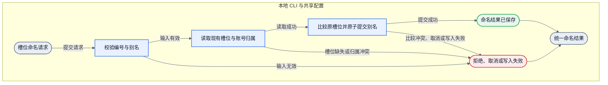
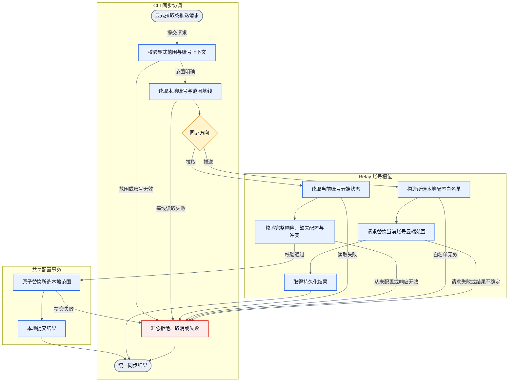
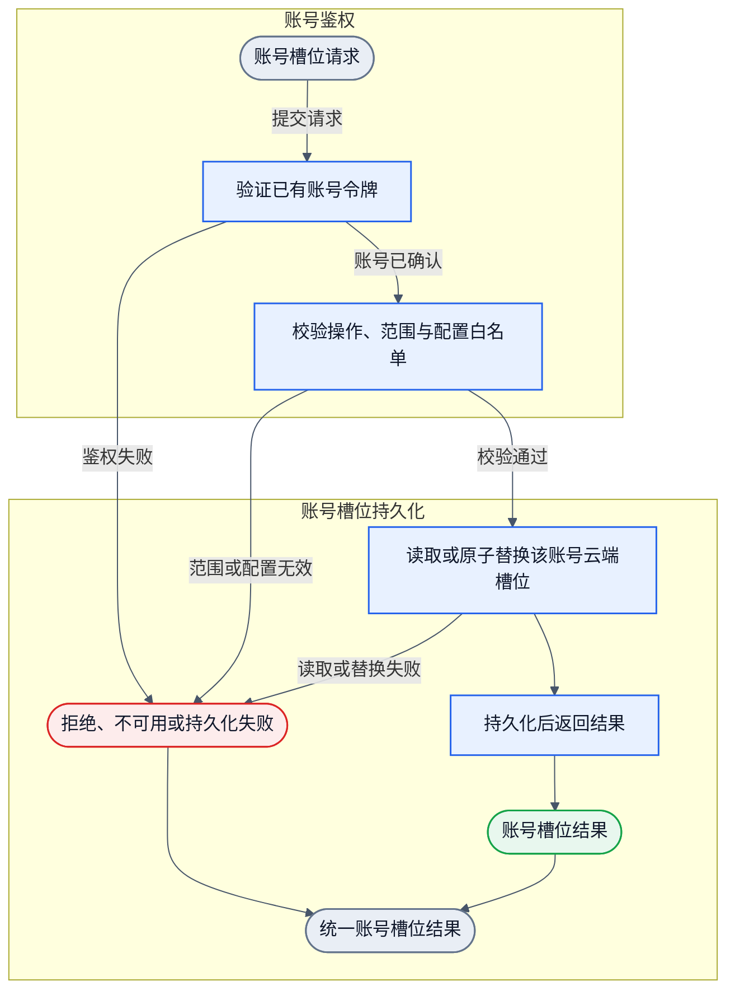
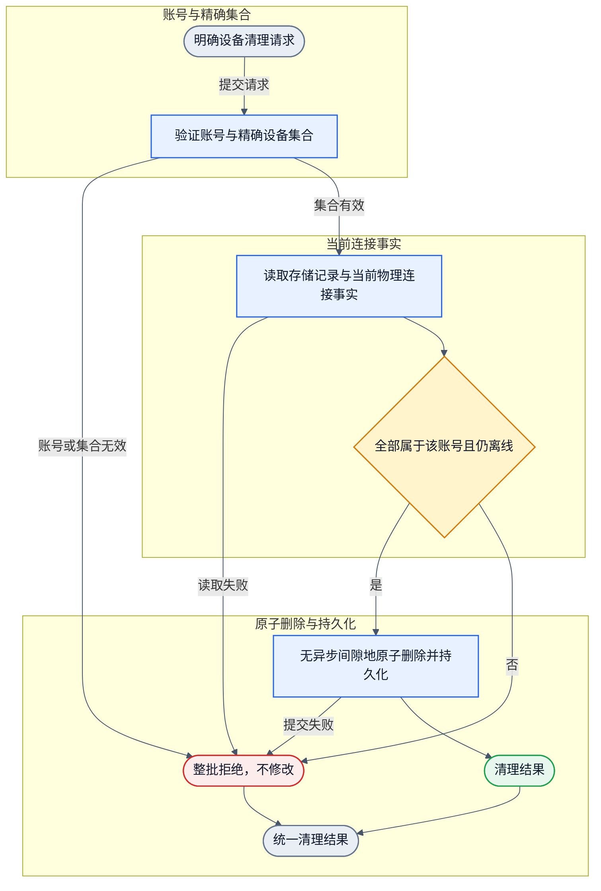

# 2026-10-21 CLI 槽位命名与账号云同步 DAG 决策草稿

状态：`DAG_PASS`；详细设计已独立审查通过。实现与验收正在推进，生产部署尚未完成。

本文只记录已批准的 SESE 对象流和唯一 owner 边界。它不是实现完成、算子注册、运行时行为或生产部署的证明。

## 1. 范围与决策依据

用户范围是 Windows、macOS、Linux 的 `zterm` CLI：为 1～20 号槽位增加可选别名、可读列表、按单个槽位或全部槽位显式拉取云端配置，以及按单个槽位或全部槽位显式推送并覆盖当前账号云端配置。同时清理已确认离线的精确测试设备集合。

初始独立 DAG 评审在显式 `N | --all` 修正后为 PASS，证据为 `ART/dag-recheck.json` 与 `ART/dag-recheck-decision.json`。本决策把该已批准拓扑落盘为四个项目图文件：

| 图文件 | 对象流 |
|---|---|
| `android/docs/dagpipe/cli-slot-rename.graph.json` | 本地槽位命名请求到统一命名结果。 |
| `android/docs/dagpipe/cli-slot-sync.graph.json` | 显式拉取或推送请求到统一同步结果。 |
| `android/docs/dagpipe/relay-account-slot-config.graph.json` | 已认证账号槽位请求到统一账号槽位结果。 |
| `android/docs/dagpipe/relay-account-device-cleanup.graph.json` | 精确设备清理请求到统一清理结果。 |

既有 `cli-slot-configure.graph.json` 拓扑、稳定 session 身份语义和 launch 语义保持不变。端点拼写、存储文件选择、字段级 schema、HTTP 路径和错误码枚举由已批准的详细设计定义。本文记录图与 owner 决策，命令契约见 `packages/cli/README.md`，接口和存储由各自实现及测试承载。

## 2. 架构映射与唯一 owner

| 状态或资源 | 唯一 owner | 允许的职责与禁止项 |
|---|---|---|
| 本地共享配置锁与原子提交 | 既有 `shared.node_config` / `resource.cli_shared_config_transaction` | 只做字段保留的锁内重读、临时文件与原子 rename；槽位和账号状态只作为消费者。 |
| 本地槽位绑定与别名 | 既有 `client.cli`，由槽位存储实现 | 别名只改本地显示名；不得改机器名、session 名、目标身份或宽度模式。 |
| 本地认证代次与登录态 | 既有 account-state owner | 同步只读取 typed 基线；不得复制第二套认证解析或登录真源。 |
| 一次同步调用及其结果 | `client.cli` 同步协调 owner | 只处理显式单槽位或全部范围；禁止后台同步、自动合并和自动重试。 |
| 云端账号槽位映射 | 拟议 `relay.account_slot_config` | 只按已认证账号读写；持久化边界由详细设计评审确认；不得保存认证秘密。 |
| 用户、令牌、设备记录 | 既有 `relay.account_directory` / legacy relay store | 清理只按精确 ID 删除账号自有离线 daemon 记录；保留用户、令牌、受保护记录和无关记录。 |
| 当前物理连接事实 | 既有 relay server connection owner | 只向清理提供同步存活谓词；不得新建第二套 presence registry、observer 或定时器。 |
| 部署包与生命周期 | root deployment owner | 图产物不执行部署、重启、生产变更或资源回收。 |
| daemon 运行时 | 既有 daemon owner | 本特性不新增 daemon 运行时代码；同步只复制已保存绑定，不解析名称、不创建 session、不连接目标。 |
| 稳定 session 目标语义 | 既有槽位配置与启动 owner | 保持 `backend + stableId` 精确身份和 `existingOnly`；禁止名称回退、合成 ID、同名重绑或创建路径。 |

详细设计已批准独立的 `relay.account_slot_config` 资源 owner。云端槽位只存于现有 Relay 数据目录下的 `cli-slot-config.json`，不镜像进 legacy 用户/令牌/设备文件。旧版本回退只写 legacy 文件，因此不会删除已接受的云端配置；此机制仍须通过实际旧包回退用例验收。新模块和接口按图绑定落地，不能把设计批准冒充已注册或已实现。

## 3. 已批准对象流

以下图是业务语义示意，精确节点、边和 ARC 以对应 `.graph.json` 为准。图中只使用中文业务标签；代码算子映射只出现在第 5 节表格，不作为图形节点标签。

### 3.1 本地槽位命名

责任组：本地 CLI 与共享配置事务。

边界：命名只改本地别名；不访问网络，不改目标身份、机器名、session 名或宽度模式。成功、失败、取消和写入失败都在同一结果出口收敛。

### 3.2 显式账号同步

责任组：CLI 同步协调、共享配置事务、Relay 账号槽位。

边界：裸 `pull` 或 `push` 只返回用法错误，不发请求、不改配置。`pull N` / `push N` 只处理一个槽位；`pull --all` / `push --all` 是当前账号范围的显式整体替换。云端从未配置与已配置的空列表必须区分；从未配置的拉取失败且不改本地，已配置的空列表可以显式清空当前账号范围。拉取若会覆盖其他账号占用的编号，整次拒绝且不部分写入。同步只复制别名、绑定和宽度设置，不复制认证秘密，不自动同步，不解析名称，不创建 session，不连接目标。

### 3.3 Relay 账号槽位读写

责任组：账号鉴权与账号槽位持久化。

边界：账号范围只来自已验证令牌；请求体不能选择其他账号。读取和替换只处理该账号的槽位映射，使用有界载荷和白名单字段；认证令牌、密码、端点秘密和 daemon 配置不得进入云端槽位内容。成功响应只能在持久化提交之后返回；持久化失败必须显式失败，不得伪造成功或静默降级。

### 3.4 Relay 账号设备清理

责任组：账号与精确集合、当前连接事实、原子删除与持久化。

边界：只接受非空、唯一、精确的设备 ID 集合，不接受前缀、名称、年龄或目录位置推断。每个存在目标必须属于已认证账号、存储连接标志为离线，并且当前物理连接事实也不存在；最终检查和原子删除之间不得有异步间隙。任一目标在线、属于其他账号、仅为 client-only 或存在物理连接时，整批拒绝且不删除。已不存在的目标按显式 no-op 返回，重试安全。清理不关闭 socket，不改 tmux/session，不改写引用已删除设备的槽位绑定。

## 4. 图产物与静态校验

校验工具为 `dagpipe 0.1.1`。每个最终修改图只运行一次 `dagpipe graph validate` 和 `dagpipe graph inspect`，完整输出保存在 `ART/graph-worker-validation.log`。

| 图文件 | 图标识 | 节点 | 边 | validate | inspect |
|---|---|---:|---:|---|---|
| `cli-slot-rename.graph.json` | `cli.slot_rename@0.1` | 4 | 6 | valid | pass |
| `cli-slot-sync.graph.json` | `cli.slot_sync@0.1` | 5 | 10 | valid | pass |
| `relay-account-slot-config.graph.json` | `relay.account_slot_config@0.1` | 4 | 5 | valid | pass |
| `relay-account-device-cleanup.graph.json` | `relay.account_device_cleanup@0.1` | 4 | 5 | valid | pass |

上述结果只证明单入口、单出口、无环、输出可达和算子版本语法绑定。它不是 SDK `compile()`、算子注册、schema 兼容、effect 能力、运行时行为或黑盒验收的证明。

## 5. 拟议算子绑定

以下绑定只用于静态图表达。标为“拟议”的算子尚未注册，不得据此宣称可实现或已实现。

| 职责 | 拟议或既有算子 | 状态 |
|---|---|---|
| 请求提取 | `dagpipe.request.extract@0.1` | 既有通用静态绑定 |
| 读取本地槽位上下文 | `cli.slot_store.read_context@0.1` | 既有 CLI 静态绑定 |
| 本地别名原子事务 | `cli.slot_store.rename@0.1` | 拟议，未注册 |
| 读取本地共享配置快照 | `shared.config.read@0.1` | 既有静态绑定 |
| 显式同步协调 | `cli.slot_sync.coordinate@0.1` | 拟议，未注册 |
| 拉取后的本地原子提交 | `cli.slot_store.commit@0.1` | 既有 CLI 静态绑定 |
| 账号鉴权 | `relay.account_slot_config.authorize@0.1` | 拟议，未注册 |
| 账号云端槽位读取或替换 | `relay.account_slot_config.apply@0.1` | 拟议，未注册 |
| 清理鉴权与精确集合校验 | `relay.account_device_cleanup.validate@0.1` | 拟议，未注册 |
| 清理存活检查、原子删除与持久化 | `relay.account_device_cleanup.apply@0.1` | 拟议，未注册 |
| 结果收敛 | `dagpipe.result.collect@0.1` | 既有通用静态绑定 |

不新增第二套 registry、SDK 框架、运行时或 daemon 客户端状态。

## 6. Owner、输入状态、结果、失败边界与停止条件

### 6.1 本地槽位命名

| 项目 | 契约 |
|---|---|
| 输入状态 | 一个槽位编号和一个别名；本地共享配置中的现有槽位、账号归属和原值。 |
| 唯一 owner | CLI 槽位 owner 拥有别名与槽位真源；既有共享配置事务 owner 拥有锁、比较和原子提交。 |
| 结果 | 一个命名结果：已保存、拒绝、取消或失败。 |
| 失败边界 | 编号越界、别名为空或含控制字符、槽位缺失、账号归属冲突、原值比较冲突、取消、写入失败。失败不得改目标身份、机器名、session 名或宽度模式。 |
| 停止条件 | 不访问网络，不重试，不自动迁移旧槽位；返回结果后停止。 |

### 6.2 显式账号同步

| 项目 | 契约 |
|---|---|
| 输入状态 | 显式方向与范围：`pull N`、`pull --all`、`push N` 或 `push --all`；本地账号与槽位基线；当前账号云端状态。 |
| 唯一 owner | CLI 同步协调 owner 拥有一次调用、范围校验和远端结果；共享配置事务 owner 拥有拉取后的本地提交；relay 账号槽位 owner 拥有云端读取与替换。 |
| 结果 | 一个同步结果：已拉取、已推送、拒绝、结果不确定、失败或取消；结果必须说明已知副作用和未确认状态。 |
| 失败边界 | 裸命令、混合范围、重复参数、越界编号在请求前失败；认证失效不改本地；从未配置的拉取不改本地；单槽位缺失失败；其他账号编号冲突整次拒绝；载荷无效不部分替换；本地提交失败不部分写入；远端结果不确定只报告，不声称回滚或自动重试；推送已发出后本地登出不能撤回。 |
| 停止条件 | 不自动同步、不自动重试、不自动合并、不解析名称、不创建 session、不连接目标、不复制认证秘密；返回结果后停止。 |

### 6.3 Relay 账号槽位读写

| 项目 | 契约 |
|---|---|
| 输入状态 | 已认证账号请求；操作与范围；有界槽位载荷；当前账号已有云端状态。 |
| 唯一 owner | 拟议 relay 账号槽位 owner 拥有账号范围、读取/替换和持久化结果；账号身份只来自鉴权 owner。 |
| 结果 | 一个持久化结果：读取成功、替换成功、拒绝、不可用或持久化失败。 |
| 失败边界 | 鉴权失败、请求选择其他账号、未知或越界槽位、重复编号、无效 backend/widthMode、控制字符、超限载荷、持久化失败。失败不得部分替换，不得把从未配置当成已配置空列表，不得返回未持久化的成功。 |
| 停止条件 | 持久化边界按详细设计评审确认；不保存认证秘密；不静默降级；返回结果后停止。 |

### 6.4 Relay 账号设备清理

| 项目 | 契约 |
|---|---|
| 输入状态 | 已认证账号；非空、唯一、精确的设备 ID 集合；存储记录、连接标志和当前物理连接事实。 |
| 唯一 owner | 拟议清理校验 owner 拥有账号和精确集合校验；legacy relay store 拥有删除与持久化；既有物理连接 owner 提供同步存活事实。 |
| 结果 | 一个清理结果：已删除、显式 absent、整批拒绝或失败。 |
| 失败边界 | 空集合、重复或超限 ID、其他账号占用、client-only 记录、存储连接标志在线、当前物理连接存在、持久化失败。任一不合格整批拒绝；最终检查和删除之间不得有异步间隙；已 absent 不产生新副作用。 |
| 停止条件 | 不按前缀、名称、年龄或目录位置删除；不关闭 socket；不改 tmux/session；不改写槽位绑定；不撤销设备身份；返回结果后停止。 |

## 7. 未注册运行时绑定与明确非声明

下列拟议算子没有注册到项目 SDK，也没有 `compile()` 或运行时执行证据：

- `cli.slot_store.rename@0.1`
- `cli.slot_sync.coordinate@0.1`
- `relay.account_slot_config.authorize@0.1`
- `relay.account_slot_config.apply@0.1`
- `relay.account_device_cleanup.validate@0.1`
- `relay.account_device_cleanup.apply@0.1`

既有 `dagpipe.request.extract@0.1`、`shared.config.read@0.1`、`cli.slot_store.read_context@0.1`、`cli.slot_store.commit@0.1` 和 `dagpipe.result.collect@0.1` 也只是静态图绑定，不证明当前项目 registry 已注册或运行时已接线。本文不声明算子已实现、接口已上线、云端已可同步、设备已清理、生产已部署或任何黑盒行为已通过。

## 8. 停止条件与下一动作

本 worker 在四个图和本决策草稿落盘后停止，不进入实现、测试、部署、生产清理或 Git 操作。下一动作是独立详细设计评审，重点确认云端持久化 owner、端点与存储边界、字段级 schema、失败码和回滚兼容性；通过后由 root 对齐受影响绑定、补 gate 与红测，再进入实现。
