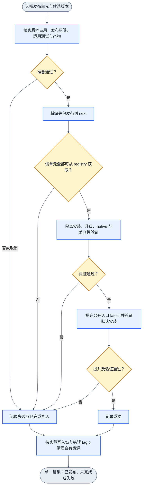

# CLI 与 daemon 标准 release 流程

状态：已制定的发布契约；发布自动化待实现。执行计划见 [release plan](../goals/cli-daemon-release-plan.md)。本轮只重装 CLI 和制定流程，不执行公开发布。

## 范围与版本 owner

| 发布单元 | 版本真源 | 约束 |
| --- | --- | --- |
| `@jsonstudio/zterm-cli` | `packages/cli/package.json` | 独立版本，当前候选 0.1.4；唯一命令 `zterm`。 |
| daemon launcher 与三个 payload | packager 的显式 `--version`；当前 CI 从 `android/package.json` 取默认值 0.1.3 | 四包必须同版本。launcher 精确依赖三个 payload；payload 不拥有 bin。 |

固定平台为 `darwin-arm64`、`linux-x64`、`win32-x64`。Node 22 是现有 CI 基线；安装还须符合包声明的 Node/ABI 及 native 加载契约，不能由 `engines >=22` 推断所有 Node 主版本都已验收。Android APK/OTA、Mac/Windows GUI 和 Relay 部署保留各自发布 owner。

CLI 与 daemon 是两个独立发布单元。每个单元分别产生结果；CLI 发布失败不自动撤回已验证的 daemon。若新 CLI 依赖新 daemon，先完成 daemon 稳定发布，再提升 CLI。

## 当前事实与执行前未知项

- 2026-10-24 的公开 npm 查询：CLI 返回 E404；daemon `latest` 为 0.1.2。源码候选分别为 CLI 0.1.4、daemon 0.1.3。E404 不证明从未发布，也不证明版本号可复用。
- PR #170 的适用 CI 已通过；现有 `cli-platform.yml` 提供三平台 CLI、daemon payload、四包聚合和安装验证。工作流没有 npm publish / tag promotion 阶段。
- `verify-release-assets.mjs` / `publish-github-release.sh` 仍耦合 Android APK manifest，不能直接充当 CLI 独立发布入口。
- npm scope 权限、trusted publisher 配置及候选版本占用需在实际发布前核实。`npm whoami` 仅证明身份；`npm publish --dry-run` 仅检查本地打包，二者均不单独证明发布权限。不得打印 token、`.npmrc` 或完整环境。
- CLI 0.1.4 对公开 daemon 0.1.2 的兼容性尚未在本轮验证。不能由版本号推断稳定 session 身份、按需 snapshot、tmux 路由或 Relay 槽位同步能力。

## 标准流程（每个发布单元）

候选先发布到固定 `next` tag，完成 registry 安装验证后再显式提升公开入口的 `latest`。stable semver 也先走 `next`；可选 RC 只进入 `next`。不新增尚未实现的 CLI channel 参数。

这是规划流程图，具有一个入口和一个结果出口，不代表 publish 自动化已实现。现有 `cli-self-upgrade.graph.json`、`cli-daemon-install.graph.json` 分别拥有安装行为；`release-update-lifecycle.graph.json` 保留 APK 更新边界，`release-runtime-promotion.graph.json` 保留其现有运行时 promotion 职责。本轮不新增算子注册或第二份机器 manifest。

## 产物、验收与发布次序

| 阶段 | 复用入口 | 必须证明的结果 |
| --- | --- | --- |
| CLI 打包 | `pnpm --dir packages/cli run pack:release` | 安装入口、bundle、依赖及版本可用。 |
| daemon 四包打包 | `android/scripts/prepare-daemon-npm-package.mjs --version <v> --release <tuple>=<dir>`，提供全部三个 tuple | launcher 与 payload 精确同版本，平台和 native 内容匹配，无 payload bin。 |
| 发布验收 | 项目声明的全量套件与 release gates；复用仍有效的 CI 结果 | 三平台正式入口的成功、失败、升级与回滚行为；不因本轮只改文档重复构建产品。 |
| 安装与升级 | `platform-smoke.mjs`、`npm-blackbox.mjs`、`daemon-install-blackbox.mjs`、已配置的 remote CLI blackbox | 保留配置、真实 native 加载、精确目标连接、输入/镜像/退出恢复；未执行的远程用例明确列为缺口。 |
| registry 验收 | 上述 harness 的隔离环境；registry 模式仍需补齐 | 从真实公开 registry 下载指定版本，并在支持平台证明实际安装位置和行为。 |

脚本位于 `packages/cli/scripts/`，daemon packager 位于 `android/scripts/`。本地 tarball 验证不能替代公开 registry 验证。

daemon 先将三个 payload 发布到 `next`，三包均可获取后再发布 launcher。launcher 通过精确版本选择 payload，不要求移动 payload 的 `latest`。四包 registry 验证通过后，仅提升 `@jsonstudio/zterm-daemon@<v>` 的 `latest`。CLI 单独发布到 `next`，验收后提升 `@jsonstudio/zterm-cli@<v>`。

兼容矩阵覆盖候选 CLI × 候选 daemon、候选 CLI × 当前支持的稳定 daemon，以及声明支持的旧 CLI × 候选 daemon。矩阵须验证稳定 session 身份、精确路由、snapshot 成功/不可用/身份失败、账号和 Relay 槽位同步能力；没有证据的组合不得宣称兼容。若缩小支持范围，先明确最低能力及用户升级路径。

## 隔离与运行态保护

安装前检查实际 `node`、`npm`、`zterm` 路径、Node 版本、动态库及 native 加载。发现损坏先修真实 runtime owner；不通过修改 CLI shebang 或复制 native 文件绕过。Air 本轮通过 Homebrew 切到已有 Node 22 修复默认入口，不把该机器操作写成所有平台的强制步骤。

隔离 registry smoke 同时隔离 HOME（Windows 包含 USERPROFILE）、`npm_config_prefix`、cache 和 userconfig，并证明写入只发生在自有目录。POSIX 全局 bin 在 `<prefix>/bin`；Windows 使用 `<prefix>/zterm*.cmd`。只把 CLI 装到临时 prefix 不足以隔离 `zterm daemon install`：它会另查 npm global prefix，并写 home 下的 staging/shim。不能让测试误改用户全局安装。

安装、升级和回滚保留 `~/.zterm/config.json` 中的账号、槽位、daemon 配置和其他字段。发布记录不保存秘密。包安装与激活分离：不得自动启动/重启 daemon、tmux 或 Relay。需要激活新 daemon 时，单独执行正式服务 restart，并说明连接中断和维护边界；不得用 stop/start 或批量终止替代。

## 中断、回滚与完成标准

- npm 的 `name@version` 不可覆盖。瞬时故障后，可复用已发布且验收有效的包，只补发缺失包；内容错误则给受影响发布单元分配新版本，daemon 四包仍同版本。按实际误导风险决定 deprecate，不自动 unpublish。
- 提升前记录公开入口原 tag。部分提升或默认安装验证失败时，记录实际完成写入并恢复该单元原 tag；恢复失败也必须报告。不得把计划中的 tag 当作已完成。
- 首次公开 CLI 没有旧 `latest` 时，错误提升应移除错误 `latest`；错误 `next` 另按实际状态处理。保留已验证本地 tarball 作为主机恢复来源。
- 移动 tag 不会回滚已安装机器。主机使用 `npm install -g @jsonstudio/zterm-cli@<prior>`（或先前 tarball）及 `zterm daemon install --version <prior>` 显式恢复。只有已激活的错误 daemon 需要单独 restart。
- `zterm upgrade` 当前按目标版本字符串是否相等决定安装，不提供 `--version` / `--channel`。tag 回退会影响后续执行 upgrade 的机器，不能当作当前机器恢复回执。
- 完成须同时具备 registry 指定版本可获取、默认 tag 安装可用、适用平台与兼容矩阵通过、自有资源清理及真实结果记录。用户反馈只给版本、支持范围、安装/升级入口、需要操作的兼容变化和剩余缺口；详细记录留在发布证据中。
