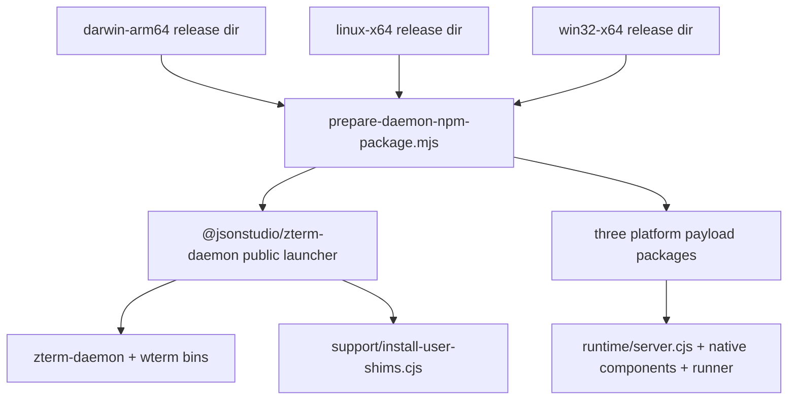

# CLI Wiki

Worker-readable CLI map. Generated diagram: `docs/wiki/generated/cli.html`.

## Owners

- `feature_id`: `daemon.cli_shell`
- Remote CLI package: `packages/cli/src/main.ts`
- CLI bin: `packages/cli/bin/zterm.mjs`
- Public CLI package: `@jsonstudio/zterm-cli`
- Shared configuration: `packages/shared/src/node/shared-config.ts`
- Daemon source runner: `scripts/zterm-daemon.sh`
- Windows daemon runner: `scripts/windows/zterm-daemon.ps1`
- Native helper: `scripts/native/zterm-daemon.swift`
- Global daemon install shim: `scripts/install-global-daemon-cli.sh`
- Release staging: `scripts/prepare-global-daemon-release.sh`
- Three-platform daemon packager: `scripts/prepare-daemon-npm-package.mjs`
- Public daemon package: `@jsonstudio/zterm-daemon`
- Public daemon bins: `zterm-daemon` and legacy alias `wterm`

The remote CLI and daemon package are separate release surfaces. `zterm` is the
user CLI. `zterm-daemon` runs or manages a daemon installation.

Release ownership and next/latest policy: [CLI/daemon standard release process](../decisions/2026-10-24-cli-daemon-release-process.md). Current milestones and publication gaps: [release plan](../goals/cli-daemon-release-plan.md).

## Remote CLI Commands

| command | owner | side effects | gate |
| --- | --- | --- | --- |
| `zterm login` | account/auth owner | authenticates and atomically stores local CLI auth in `~/.zterm/config.json` | account-state and real login path |
| `zterm login --from-config` | account/auth owner | consumes one-shot login password before authentication | account-state and config transaction tests |
| `zterm logout` | account/auth owner | advances local auth generation and removes CLI auth; preserves slots, daemon config, and unrelated fields | stale-identity and logout tests |
| `zterm slot list` | slot owner | reads local slot bindings only | slot-store tests |
| `zterm slot rename <1..20> <name>` | slot owner | changes only the local alias, including while logged out | slot-store and slot command tests |
| `zterm slot pull <1..20>\|--all` | sync coordinator and slot owner | atomically replaces the selected local account scope from cloud; rejects foreign-number collisions | sync coordinator and installed cloud blackbox |
| `zterm slot push <1..20>\|--all` | sync coordinator and Relay account slot owner | explicitly overwrites the selected cloud account scope with saved bindings | real HTTP API and installed cloud blackbox |
| `zterm slot set <1..20> [--width-mode ...]` | slot owner | resolves exact server and stable session, optionally previews, then commits the slot | slot, catalog, and snapshot tests |
| `zterm <1..20>` | CLI connection owner | connects the exact saved binding and renders the canonical mirror | installed blackbox path |
| `zterm` | slot selector and CLI connection owner | selects one existing slot; it does not refresh the server catalog | no-slot and selection tests |
| `zterm upgrade [--registry <url>]` | CLI release adapter | upgrades only `@jsonstudio/zterm-cli` in the detected npm prefix | npm isolation suite |
| `zterm daemon install [--version <version>] [--registry <url>]` | daemon package adapter | installs the public launcher and matching payload; it does not start a service | daemon-management tests |
| `zterm daemon status` | existing daemon status owner | delegates the absolute installed daemon entry and preserves exit/status truth | daemon-management tests |
| `zterm daemon config` | shared config projection owner | prints real path and redacted typed values; it does not migrate or write config | config tests |

The only normal configuration path is `~/.zterm/config.json`. CLI and daemon
own different typed sections. Read-only commands do not migrate `~/.wterm`.

Slot names travel with the saved binding. Sync excludes credentials and daemon
configuration. A full pull replaces only the active account's local slots;
a full push replaces its complete cloud set. Empty is an intentional clear.
An account with no saved cloud configuration fails pull without local changes.
Bare pull/push and mixed single/all scopes are usage errors. See
`packages/cli/README.md` for the overwrite and cancellation behavior.

Relay cloud state has one owner, `RelaySlotConfigStore`, at
`dirname(actual STORE_PATH)/cli-slot-config.json`. The legacy users/tokens/devices
store does not mirror it. The authenticated exact-batch device cleanup route
checks current stored presence and physical connection maps before its atomic
commit. It does not revoke tokens or close sockets.

`Ctrl+] q` disconnects only the local CLI and restores terminal state. It does
not delete or stop the remote session. Other `Ctrl+]` sequences scroll, pan,
return to follow, or send a literal prefix.

## Requirements And Status

- Node.js 22 or newer.
- Fixed platform tuples: `darwin-arm64`, `linux-x64`, `win32-x64`.
- macOS arm64 full user path passed from an isolated npm tarball.
- npm isolation upgrade passed 8/8.
- Public npm publication is pending.
- Windows x64 and Linux x64 native payload, installed CLI, and daemon installation
  gates passed in CI. Windows remote acceptance passed in run 39707241211 with
  actual RTC relay/relay statistics and the original 2500 ms connection budget.
- Independent review findings are closed: pinned socket routing survives catalog
  refresh, and ambiguous same-name sessions omit observations without exact
  provenance. Integration status is tracked in PR #167.

## Daemon Distribution

The daemon distribution has one public launcher package and exactly three
platform payloads:

```text
@jsonstudio/zterm-daemon
@jsonstudio/zterm-daemon-darwin-arm64
@jsonstudio/zterm-daemon-linux-x64
@jsonstudio/zterm-daemon-win32-x64
```

The public package is the only bin owner. Each payload contains its runtime,
DAGpipe native, `node-pty`, `wrtc`, terminal config command, platform runner,
and `zterm-package.json`. The Darwin payload also contains the Swift helper.



Pack with explicit version and release inputs:

```sh
node android/scripts/prepare-daemon-npm-package.mjs \
  --version <daemon-version> \
  --release darwin-arm64=<release-dir> \
  --release linux-x64=<release-dir> \
  --release win32-x64=<release-dir>
```

The retired single-host no-argument flow must not be used. The
`android/package.json` Node script remains the entry point; pnpm or CI passes
the required arguments.

## Daemon Commands

| command | owner function | side effects | gate |
| --- | --- | --- | --- |
| `run` | `run_foreground` | stages daemon runtime and `exec`s `server.cjs` | daemon runtime truth tests |
| `start` | `start` -> platform service or direct process | launchd / Windows Scheduled Task start or direct pid-file process | port ready check |
| `stop` | `stop` -> platform service or direct process | launchd bootout / Windows Scheduled Task stop / explicit pid termination | port closed check |
| `restart` | `restart` -> platform service or direct stop/start | service-scoped restart only | ready check |
| `status` | `status` | prints direct/service health | status smoke |
| `service-status` | `status_service` / `Invoke-ServiceStatus` | reads launchd snapshot or Windows Scheduled Task state | service gate |
| `install-service` | `install_service` / `Invoke-InstallService` | writes plist or registers `ZTermDaemon`, primes macOS permissions, bootstraps service | service script test |
| `uninstall-service` | `uninstall_service` / `Invoke-UninstallService` | bootout/remove plist or unregister Windows task and clean owned legacy task state | service script test |
| `configure-relay` | `configure_relay` / `Invoke-ConfigureRelay` | delegates typed shared-config writes through `support/terminal-config-command.cjs` | daemon-config test |
| `config` | `config` / `Invoke-Config` | prints redacted shared config projection | daemon-config test |

The source shell entry waits for installed package-version support and owns no
lifecycle implementation. The public npm launcher resolves the matching payload
and sets `ZTERM_PACKAGE_ROOT` before invoking its runner.

## No-Go

- Do not add broad process kill commands.
- Do not add a bin to a platform payload.
- Do not use the no-argument single-host packer flow.
- Do not claim public npm availability from a local tarball.
- Do not claim three-platform acceptance from macOS evidence.
- Do not make `status` imply readiness unless listener truth is verified.
