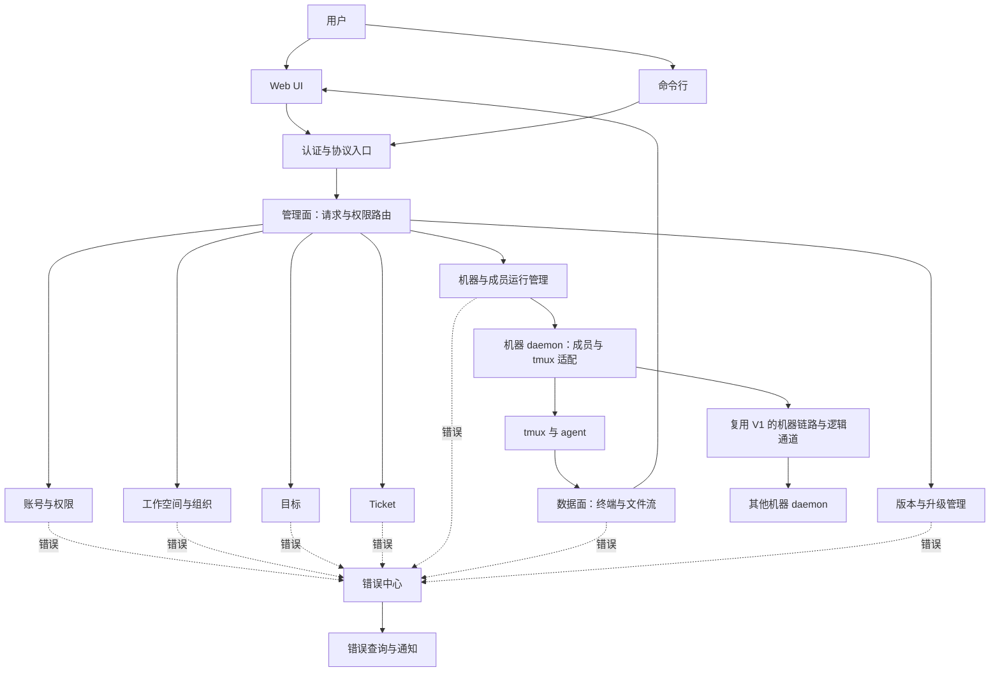

# Zterm V2 非 GUI 架构与文件结构草案

状态：讨论稿，2026-11-02。本文是新产品 V2 的目标设计，不代表现有 Android runtime architecture v2 已具备这些能力，也不是实现计划或已验证的交付。

当前详细设计入口：
- [全模块结构与执行进度索引](mvp/module-execution.md)：逐模块 DESIGN、开发计划与联调场景统一入口；Jenny执行交接。
- [Connections 模块设计](../modules/connections/DESIGN.md)及逐模块实践路径：先本地组、再跨机组，ticket 并行组合；由 Jenny 派执行。
- [正式根与模块结构决策](decisions/product-root.md)：同仓 v2/ 产品根，沿用 zterm LayerFS 项目；取代此前目录待裁决项。
- [MVP 跨模块接口概要合同](interfaces/mvp-contracts.md)：公开端口、状态写入权、组合依赖与真实入口验收。
- [MVP 与执行交接](mvp/scope-and-handoff.md)：最新范围、拆分依赖、验收和 Jenny 执行职责。
- [Ticket 选型与集成设计](../modules/tickets/DESIGN.md)：Vikunja 评估、真源划分及接入验证。
- [Relay 账号、注册与跨机器信任](../modules/accounts/DESIGN.md)：当前主线，账号/机器/授权数据结构和生命周期。
- [基础模块分类与依赖](module-boundaries.md)：基础层与业务层、owner、AppSDK/DAGpipe 纳管边界。
- UX 任务书：已确认界面需求及后续用户补充。

以上专项稿展开本文对应章节，未决定项不因落盘变成已批准实现方案。正式 AppSDK 根尚未建立。

## 设计统筹与开工边界（用户最新确认）

- David 统筹新产品 V2 的所有设计，负责系统分层、接口与状态 owner、设计整合和审计，向 Jenny 汇报。Jenny 继续负责项目总体协调与集成交付。
- UX 设计、静态 HTML、图标及其他视觉资产由 UX 设计师提供；所有新设计先交 David 审计，不能凭设计师自检直接进入实现。
- Jenny 将独立执行包交给可用 peer，由 peer 安排 GCM 执行。AppSDK、DAGpipe、工作线和集成由 Jenny 负责。David 只做统筹、架构、概要/详细设计与审计，不执行产品或治理变更。
- 用户已明确第一版 MVP：完整 WebUI 表面、跨机器连接、本地与跨机器 group，并优先评估现成 ticket 系统。按最新范围编制执行包；相关 UX 与 MVP 设计审计仍须通过后才进入实现。当前既有 HTML 草稿不算正式 UX PASS。
- AppSDK 是需求、模块/资源 owner 和公开契约管理入口；DAGpipe 管理业务图及相应 gate 的拓扑与算子绑定。行为 gate 必须绑定真实失败模式和公开入口，静态图校验不等于行为验收。
- 正式 V2 根目录与 LayerFS 工作线由 Jenny 协调后落地；不能在 V1 dirty 主树或旧 Android runtime-v2 管理目录冒充新项目初始化。新项目 prepare 材料先具体化，再按 AppSDK 正式准入规则完成确认/init/verify，不伪造用户确认。
- 不引入退役的 SHA 包装、冻结链或只锁源码文本的 gate。复用有效证据；新增方案未知项仍保持显式待定。

## 1. 目标与原则

构建一套跨机器管理分层 workspace 和 agent 的系统：每台机器运行 daemon；CLI、Web UI 和后续客户端使用公开接口；成员使用 tmux 工作空间；目标、ticket 和 board 支持分层管理与追踪。继承用户确认的账号权限、workspace 合并、按机器恢复及巡检需求。

模块按能力分工，各自拥有自己的状态和契约。管理面、业务数据面、错误面分开；控制决策不得藏在业务数据或日志中。所有成员通信经 daemon 统一投递，状态可独立查询与订阅。机器通信复用 V1，宿主与 agent 产品分别适配，ACP 为后续会话协议适配。独立代码边界、独立发布和独立运行是不同级别：先使模块可以独立开发、测试与版本化；只有实际需要在线独立升级的模块才拆成独立进程。

## 2. 逻辑总览



该图只表示模块边界，不是满足 SESE 的业务执行图。每个真实入口的对象流在开发前单独形成项目 DAG 并校验。现有 `android/docs/dagpipe/daemon-control-dispatch.graph.json` 与 `daemon-mirror-publish.graph.json` 是已有产品对应路径的参考，不能当作新产品实现或直接复用证明。

## 3. 三条面

| 面 | 负责 | 典型内容 | 不负责 |
| --- | --- | --- | --- |
| 管理面 | 认证、授权、路由请求，交由唯一业务 owner 执行 | 创建组织、派单、配置连接、启动/恢复、版本查询、订阅意图 | 终端正文、文件正文、直接持有业务模块状态 |
| 数据面 | 将业务内容按其契约传送给对应消费者 | 终端内容与输入、文件数据、ticket 内容及查询结果 | 从正文重建权限、连接状态、任务状态或升级决策 |
| 错误面 | 统一接收、归一化、关联、呈现错误与处理状态 | 来源、类型、影响范围、原因链、可观察处理结果 | 代替业务 owner 决定重试、完成、回滚或修改业务状态 |

WebSocket 是传输实现之一，不等同于机器通信抽象。底层应复用 V1 的机器发现、连接路由、穿透、物理连接及终端能力。上层通过类型明确的通道访问，不直接依赖 WebSocket/RTC。控制、数据、状态和错误分别使用自己的协议类型；流量隔离及背压按实际承载能力设计，不能把管理字段混进终端正文。

### 3.1 结合 V1 的通信分层（本次修订）

用户明确：现有基础通信必须复用，所有成员投递经 daemon 集中受理与路由；集中管理同时须保证状态可获得。此前仅用一个 `transport-ws` 加若干产品适配器表达通信过粗，现修正为以下独立职责。

```text
目标 / ticket / 巡检 / CLI / Web
                  │
       本机 daemon 的公开接口
                  │
       投递管理：授权、成员解析、投递记录与回执
          ┌───────┴────────┐
          │同机           │跨机器
          │        机器链路：发现、路由、穿透、连接
          │                │
          │           目标机器 daemon
          └───────┬────────┘
            当前成员绑定与宿主适配
          ┌───────┼────────────┐
          tmux    DSH gateway  Codex Desktop bridge
          │       原生会话      原生会话
       agent 适配
       Codex / Claude Code / 已验证的其他 TUI

后续 ACP：作为成员会话协议适配，接入相同投递入口。
```

- `machine-link`：只关心目标机器、机器身份、可达端点、物理连接及流控。承接 V1 的 LAN、IP、Tailscale、RTC direct/relay 等经验证路径；具体候选与顺序沿当前正式配置。信令与 TURN 转发分开，不把所有 relay 等同。成员宿主不得各写一套穿透。
- `channels`：在机器链路上提供类型明确的逻辑通道，例如成员通知、状态、终端和文件。终端/文件拥塞不得挤占必要控制状态；单通道失败只影响该通道。复用实际可用的 V1 mux 与背压边界，不以接口存在冒称所有运行端已接入。
- `delivery`：daemon 统一持有投递状态、稳定消息 ID、接收与消费回执。ticket 是业务追踪真源，投递仅携带 ticket 引用、通知和必要操作；投递记录不成为第二套任务系统。本机和跨机器共用授权、身份及回执语义，只有承载路径不同。
- `member-binding`：持有成员稳定身份到当前机器、宿主、会话和 anchor 的 typed 绑定。成员不是 session ID；更新会话时更新绑定代次，旧回执不能覆盖新会话状态。tmux pane 是定位端点，不是组织身份。
- `host-adapters`：适配 DSH gateway、Codex Desktop bridge、tmux 等宿主的实际投递与状态能力。宿主与 agent 产品分开；DSH 即便运行于 tmux 内，也不能把 tmux pane 当作原生投递身份。
- `agent-adapters`：适配 Codex、Claude Code、AGY 等产品实际支持的启动、session 发现、恢复与输入语义。AGY 的原生入口或 TUI 承载须按实际能力确认，不能因名称就归入 tmux。共同能力按接口表达，不支持的能力明确报告，不能强行用按键模拟全部原生能力。
- ACP 接入 `agent-session` 契约；它可能承载 prompt、事件、工具调用或会话恢复，具体依协议能力。它不替代机器穿透、账号权限、ticket 或 daemon 目录；CLI/Web/业务模块不直接依赖 ACP。

tmux 成员的 TUI 观看与输入继续使用 zterm 的终端基础通信和 wterm 渲染能力。机器链路、terminal mirror 和宿主投递分别拥有自己的状态。V2 的组织、ticket 和 agent 状态不能塞进 V1 mirror owner。

用户最新明确 sessions 工作台采用 iTerm2 式多 panel：左侧突出 master，右侧 peer 网格，同时显示、切换并拖动分隔线。新增客户端 `session-layout` owner 管窗格树、布局、可见成员及输入焦点；只消费终端 capability，不拥有终端正文、会话身份或组织角色。拖动/隐藏/切换不重建物理连接、不终止成员。窗口尺寸的显示效果与真正 tmux resize 分开，沿 V1 mirror-fixed/adaptive owner 边界，不让布局组件直接写 daemon mirror。该 owner 属于 Web 客户端，可后续由桌面壳复用。

布局默认突出 master，但允许将任意 peer 设为主窗格；这只是视图位置变化，不是角色变更。`session-layout` 提供默认布局、编辑、保存和恢复默认。保存内容使用稳定成员引用、窗格树、顺序与比例，不持久化终端正文或直接持久化临时 transport/session 作为成员身份。账号/设备/workspace 的保存范围及同步策略仍待定；若由 daemon 持久保存，应属于独立视图配置资源，不进入 terminal mirror、机器 transport 或成员业务真相。失效成员引用要显式显示，不自动匹配同名成员。

用户最新纠正（Jenny 转达，2026-11-02）：大屏“一加四”仅定义重点窗格与普通窗格的比例，不限制总窗口数或一屏数量。左侧突出窗口、右侧按同一网格连续排列其余窗口，整体滚动查看；不得把第 5 个 peer 起强制收纳为待命栏。R4 中固定四槽的通过证据仅保留历史比例验证，不能作为新布局准入。页面压缩非必要标题、说明和配置占用，让真实视口优先呈现终端。

手机端布局采用竖屏友好的基础窗格与可平移/缩放的无限画布；聚焦 session 后进入适配竖屏的终端操作视图，返回概览恢复原画布视点。画布相机位置/缩放、窗格位置/比例、当前焦点由客户端 layout owner 管理；终端 buffer、transport 和 tmux geometry 保持原 owner。缩放概览不直接触发 tmux resize，切焦点不重新创建会话或连接。布局结构不变换成员角色。终端输入焦点与画布导航手势必须分开；具体手势分配由 UX 审计后确定。只订阅实际可见/焦点所需终端内容，画布无限不代表后台无限读取；减少不可见订阅不关闭成员会话。桌面与手机布局保存隔离/同步策略待定。

手机 session 预览提供 workspace 快捷浮窗按钮。当前 workspace 的切换及各 workspace 的布局/视点/焦点恢复由客户端 workspace navigation 与 session-layout 协作，不触发组织变更或成员生命周期操作。切换只调整必要可见订阅，不断开健康的共享机器连接。快捷项选择与保存策略为 UX 待定项。

手机最新交互约束：先浏览多窗口并选择；选定后只显示当前主屏，成员切换沿上下空间组织，不使用左右成员切换。此前概览相机能力可保留，但不据此让聚焦视图继续展示多个终端。终端内上下滚动与成员切换需有明确区域或模式边界，不能抢占终端历史滚动；具体交互由 Emma 交付并审计。workspace 快捷入口继续独立保留。

窗口直接拖边调整尺寸；每窗一行标题栏提供 board/bug list 等属性入口，在该窗口下方展开面板。手机复用同一组件和布局模型，页面保持独立，业务状态仍从各自公开端口获取。“巡检目标用户”查看/编辑与“下属管理”的任务、bug、task q 入口纳入 UX；术语未定处保留原文，不据猜测建立业务写入。当前细化要求见 垂直布局审计合同。

### 3.2 daemon 统一投递与状态可获得性

“中心化”指每台机器的 daemon 是该机统一入口，不是所有机器必须经过一台新增的全局中心服务器。跨机器仍由 daemon 对 daemon 通信。组织层级和业务权限不改变这个通信路径。

daemon 提供状态查询与状态订阅，查询不需要向 agent 发送消息，不等待目标 TUI 响应，也不默认捕获终端内容。宿主适配器读取宿主正式状态接口，或接收正式事件；tmux 仅能证明存在/可达时，不能据此宣称 agent 正在工作或已完成。

| 状态 | 权威来源 | 可报告的结果 |
| --- | --- | --- |
| 机器通信 | 本机链路 owner | connecting / connected / unreachable / unknown |
| 成员绑定 | 绑定 owner 与宿主验证 | 当前会话、代次、绑定有效性 |
| 成员运行 | 宿主/agent 正式状态 | busy / idle / waiting / stopped / unknown，按实际支持能力 |
| 投递 | daemon 投递 owner 与目标回执 | 本地受理、目标 daemon 收到、宿主受理、成员消费；不能推导为任务完成 |
| 目标与 ticket | 对应业务 owner | 当前业务状态；不从终端输出猜测 |

状态返回值至少带来源、观察时间、当前绑定代次及新鲜度。断线时可以展示最后已知值，但必须同时标记当前未知；未知时间不计入已确认忙碌或空闲时长。机器在线、宿主在线、agent 忙闲和 ticket 完成分别表达。

CLI 与 Web 共用 daemon 状态接口。首次查询取得状态快照，之后订阅变更；订阅重连时用 owner 的当前状态重新对齐，只有确实需要历史增量时才增加游标续传。快照是只读投影，不能被拿来重建身份或业务控制决策。状态查询和必要控制消息不能排在大文件或终端正文队列后无限等待。

本机 daemon 运行时，可查询其持有的状态及远端最后已知状态。若本机 daemon 自身不可用，实时查询必须明确失败；可由独立的本机服务状态检查报告 daemon 是否运行，但不得伪造业务状态。首期不据此承诺全局高可用或零停机。

### 3.3 已读 V1/Collab 依据与缺口

本轮是代码和文档只读核查，未进行运行态或跨机器验收。

- `packages/shared/src/connection/traversal/types.ts` 定义机器连接路径、typed failure、attempt、诊断和候选；证明已有连接抽象，不证明新 daemon-to-daemon 路径已复用。
- `android/src/server/daemon-app-messaging-runtime.ts` 的 `connectPeer` 目前调用 `createSocket(target.wsUrl, target.authToken)`，默认构造 WebSocket。V1 `/app` 消息路径与 terminal traversal 不能视为已统一。V2 应把其链路依赖移到共同机器通信端口，先保留已验证消息语义，再验证 RTC/穿透承载。
- `packages/cli/src/commands/app-messaging.ts` 已区分 send、status、ack、consume；`received / delivered / consumed` 及 `result_unknown` 必须保持真实含义。V2 的统一回执需显式映射这些现有状态，不靠同名字段猜语义。
- `packages/stream-boundary/src/terminal-transport-runtime.ts` 定义 channel、generation、背压接口；这是复用候选，不代表当前全部运行端共用该实现。
- AppSDK 的 `collab/src/adapters/mod.rs`、`tmux.rs`、`dsh.rs` 和 `codex_app_server.rs` 已有宿主适配边界。DSH adapter 当前用正式 `agent-facts` 与 `enqueue`，不拥有整个 agent 生命周期；新增启动/恢复不能冒充这个已有 adapter 的能力。
- Collab 当前 Desktop 走 native bridge；TUI、DSH、Desktop 的身份锚点不同。V2 统一的是契约与能力表达，不能抹平宿主差异或在明确拒绝后改走另一宿主通道。

新增边界的开发前需补成员投递、绑定更新、状态查询/订阅三个对象流图；现有 `daemon-app-messaging.graph.json` 只覆盖原产品消息流，不能代表 V2 的宿主及状态链已闭合。

## 4. 模块与唯一 owner

| 模块 | 拥有的事实和动作 | 接口边界 |
| --- | --- | --- |
| `identity` | 账号、认证关联、授权策略与授权判断 | 对外提供授权判断；组织关系不自动等于权限 |
| `organization` | workspace、层级、成员稳定身份与归属、合并后的组织关系 | 名称按所属 group 唯一；路径用于查找，不作为唯一稳定 ID |
| `routing` | 成员可读路径到稳定身份与当前机器的解析 | 面向 `machine.group...member`；物理连通交给 machine-link |
| `goals` | 目标及其负责人、分解关系、状态 | 目标与 ticket 分开，关系由明确引用表达 |
| `tickets` | ticket 的内容、分类、状态、优先级、责任人与追踪记录 | 系统统一 ticket 事实；不让 board 保存第二份任务事实 |
| `board` | 各 manager 的查询与视图组合 | 查询目标、关联 ticket 和成员状态；每个目标的前五项按优先级计算，完整列表另查 |
| `machines` | 本机 daemon 身份、机器能力和连接状态 | 多机器状态经正式协议交换；不从日志推断 |
| `members` | 成员配置、当前会话绑定、启动与恢复的业务状态 | 分别调用宿主/agent 适配器；不替组织模块持有层级 |
| `delivery` | daemon 统一受理、路由、投递与回执 | 不将网络写入或按键提交当成消费或完成 |
| `status` | 按来源组合状态查询和订阅 | 只读投影；各状态 owner 保持唯一，不复制一套状态机 |
| `terminal` | 终端通道、数据订阅、输入与会话显示接口 | 复用经验证的 V1 能力，遵循 daemon mirror / 客户端 buffer / renderer 分离 |
| `errors` | 错误事件的统一入口、关联、查询与投影 | 接收 typed error；业务模块保留成功/失败和恢复决策 |
| `upgrades` | 本机可安装组件版本、兼容判断与明确升级结果 | 每个发布单元单独升级；安装及进程生命周期遵守实际授权 |
| `machine-link` / `channels` | V1 基础上的机器连接、穿透、握手、通道和背压 | 不决定成员身份、任务完成或宿主恢复 |

每个模块只有一个权威状态 owner。共享存储可以按模块隔离表与写入接口；其他模块通过接口读取，不能跨模块直接写表。board 是组合读取视图，不是第二套 ticket 或成员状态。

## 5. 多机状态与一致性：建议与待定项

建议首期每个 workspace 有一个明确的权威 owner，所有会改变该 workspace 组织、目标和 ticket 的请求交该 owner 提交；其他机器持有本机运行事实，通过接口同步给授权查询者。这样跨机器管理不要求每台机器都能离线改同一份组织数据。workspace 合并先明确新 workspace 的 owner，并由用户确认；原 workspace 是否保留独立性、数据迁移方式、断线期间写入策略仍需用户决定。

这只是首期建议，不代表已选定单点部署、数据库或最终协议。若必须多机离线写入，还需另行设计冲突解决、恢复顺序和权限变化，不能把最后写入当作默认正确。

稳定成员 ID 与可读路径分开。`a.Jenny` 与 `b.Jenny` 是不同成员；改名、迁移或重组后，历史 ticket 可继续引用稳定 ID。名称解析、旧地址行为和路径冲突需要单独定契约。真实投递以解析后的目标身份和授权为准。

## 6. 错误中心

模块产生结构化错误，最少包含错误类型、来源模块、操作、关联 ID、原因链及影响对象；敏感数据不进入对用户可见内容。中心负责统一归类、查询、展示和必要通知，同一请求的返回结果仍直接携带其真实错误。错误中心不统一吞错、不伪造成功、不从日志恢复业务真相。

处理顺序：模块发现错误 → 返回真实失败并报告错误中心 → owner 按契约决定恢复/重试或隔离 → 错误中心展示已知结果。数据流或其他可选能力失败不能无故中断无关功能。错误中心自身不可用时，原业务失败仍必须经调用边界返回；本地最小诊断通道记录中心不可用，不能无限递归报告，也不能为了记录失败而伪造业务成功。错误中心是否跨进程集中部署由实际运行模型决定；对外只有一个统一的错误查询与处理模型。

## 7. 发布、升级与兼容

- 首期发布单元建议为 `daemon`、`cli`、`web`；协议与共享契约独立版本化。agent 适配器和业务模块保持可独立版本化；是否每个都需要独立安装包或在线替换，由用户实际升级需求和可验证依赖决定。
- CLI、Web、daemon 独立构建与发布，不要求同版本号。每个进程声明所支持的协议版本与能力；连接时协商双方共同支持的版本与能力，无共同版本则明确报告，不能静默伪装成功。
- 协议先做可兼容扩展；需要破坏兼容的变更新增主版本，明确支持的旧版本范围、退役条件及测试矩阵。兼容逻辑位于协议边界，不复制第二套业务 owner。
- 数据 schema 由各模块 owner 管理版本与迁移。先证明升级和中断恢复；不自动保证降级。无法安全降级时应明确拒绝，避免把新数据交给不认识的旧版本。
- 每次升级先检查当前运行与兼容状态，再采用该组件正式的安装/升级及生命周期入口。失败暴露真实结果，保留原始状态；生产操作、全局 runtime 安装和进程中断遵守当前授权及项目规则。tmux server 生命周期不由升级器接管。
- V1 复用以明确的端口/适配器为边界：先核实终端流、机器发现、账号与 `/app` WebSocket 的实际公开能力及版本，再决定直接依赖或适配。不得复制 runtime 源码，不把现有 CLI 文档中的能力宣称为新 V2 的验收结果。

## 8. 关键流程草图

下面是讨论用的线性行为路径；正式开发前需要分别形成项目自有、闭合的 SESE 图，覆盖成功、权限拒绝、离线和失败结果。

1. 创建成员：CLI/Web 请求 → 认证与权限判断 → 组织 owner 创建身份 → 成员 owner 保存机器和启动配置 → 返回成员及结果。
2. 启动/恢复：请求 → 权限判断 → 机器路由 → 对应 daemon 的成员 owner → tmux/agent 适配器 → 逐项返回工作空间、tmux、agent 会话的真实结果；无法恢复 Codex 会话时明确显示，不承诺自动恢复。
3. manager board：请求 → 权限判断 → 按目标查询 ticket → 聚合直属成员状态 → 返回一个可查询结果；状态不明显示未知。
4. workspace 合并：请求 → 解析两侧身份和授权 → 预览新层级及冲突 → 用户确认 → 对应组织 owner 提交 → 返回成功或具体失败。跨 owner 的提交方式、原 workspace 保留规则尚待设计，不能预设原子完成。
5. 查看 TUI：权限判断 → 找到成员和实际机器 → 建立终端订阅 → 数据面传送内容及输入 → 明确关闭/断开结果。查看行为不应把界面状态写入 tmux mirror 真相。

## 9. 建议代码树

唯一目录设计见 [基础模块分类](module-boundaries.md) 的“用户确认的物理模块边界”：accounts、connections、daemon、host-adapters、agent-adapters、webui、android、macos、windows、linux 均拥有独立目录、DESIGN.md、src 与 tests。其他业务模块仍保持各自 owner。原 apps/modules/adapters 并列草图已移除，避免同时维护两套落地指令。

machine-link/channels 是 connections 内部独立职责；账号 identity 是 accounts 的职责；成员身份绑定、投递和状态仍按各自 owner 分离，不因统一 daemon 入口而揉进启动文件。各模块只通过公开接口依赖，正式根和语言未选择前不创建空代码架构。未来 ACP 接入适配模块，不提前实现空框架。

## 10. 首期验收与待确认

基础行为从真实入口自下而上验证：同机 daemon 与 CLI 建连及权限拒绝 → 创建 workspace/成员并按名字定位 → tmux 启动与可验证恢复 → 目标/ticket/board → 两台机器互通 → workspace 连接与合并 → Web UI 多窗口终端 → 不同版本兼容和失败结果。每项包含成功、可达失败与必要副作用证据；截图、mock 或单测不能代替真实入口。

需用户决定：

1. 首期 workspace 是否接受单一权威 owner，还是必须支持多机器断网独立写入？
2. workspace 连接与合并是两个动作吗？合并后原 workspace 能否继续独立使用，能否撤销？
3. 独立升级的最低要求：独立发布并重启所在进程，还是要求每个业务模块在线热升级？
4. 错误中心是否需要跨机器全局查询和持久保存？保留多久、哪些错误应进入 ticket？
5. 新产品代码根、语言及数据库待评估；先确认是否建立独立仓库或现有仓库中的独立主树。

现有 `packages/cli/README.md` 描述 CLI、daemon、`/app` WebSocket 与跨机器命令的已发布状态及其验收边界；`android/docs/decisions/2026-09-05-runtime-memory-truth.md` 区分终端当前实现与目标。复用前按具体版本与真实入口复核，不延伸旧验收结论。
